# UD3: Servidores de Alto Rendimiento: Nginx

!!! info "Ficha Técnica y Alcance de la Unidad"
    * **Carga Lectiva:** 4 horas presenciales
    * **Resultados de Aprendizaje:** RA1 (criterios g, h, i)
    * **Tecnologías Involucradas:** [Nginx](https://jmfiorisies.github.io/tech/nginx/)
    * **Referencias y Estándares:** CIS Nginx Benchmark, OWASP Secure Headers Project, RFC 7239 (cabecera `Forwarded`, la versión estándar de las `X-Forwarded-*`), RFC 9113 (HTTP/2)

!!! tip "Cómo está organizada esta unidad"
    Sigue el mismo orden que la presentación de clase: **(1)** por qué Nginx aguanta tanto tráfico
    con tan poca memoria (arquitectura *event-driven*), **(2)** cómo aloja varios sitios (*server
    blocks*, el equivalente a los VirtualHosts de UD2), **(★)** qué es un **proxy inverso** y para qué
    sirve, **(3)** cómo se configura con `proxy_pass`, **(4)** caché y compresión de estáticos y
    **(5)** rendimiento, límites y logs. El bloque del proxy inverso es el más importante: lo usarás
    en el resto del curso (PHP-FPM en UD4, Python en UD5, Docker en UD11).


---

## 📖 1. Fundamentos Teóricos y Arquitectura

### 1.1 El problema C10K: por qué nace Nginx

A finales de los 90 se planteó un reto con nombre propio, **C10K**: ¿puede un solo servidor atender
**10.000 conexiones simultáneas**? Con el modelo de Apache *prefork* que vimos en UD2, 10.000
conexiones son 10.000 procesos, cada uno con su propia memoria. La RAM se acaba mucho antes que la
CPU. Igor Sysoev escribió Nginx (2004) precisamente para resolver ese problema, y hoy está delante de
buena parte de las webs con más tráfico del mundo.

| Conexiones simultáneas | Un proceso por conexión (~1 MB cada uno) | Nginx (unos pocos *workers*) |
|---|---|---|
| 100 | ~100 MB | ~30 MB |
| 1.000 | ~1 GB | ~40 MB |
| 10.000 | ~10 GB | ~80 MB |

*Cifras orientativas: lo importante es la forma. Con un proceso por conexión la memoria crece en
línea recta con el tráfico; con Nginx apenas se mueve.* Para una empresa, necesitar la mitad de RAM
para el mismo tráfico significa menos máquinas, o más pequeñas, y una factura menor en la nube.

### 1.2 La analogía del camarero ágil: el modelo orientado a eventos

Imagina dos restaurantes:

- En el **restaurante Apache prefork**, cada mesa tiene su camarero fijo. Toma nota y se queda
  **parado** junto a la mesa hasta que sale el plato. Diez mesas, diez camareros, casi siempre
  quietos. Y cada camarero cobra sueldo: eso es la memoria.
- En el **restaurante Nginx** hay **un** camarero muy rápido. Toma nota en la mesa 1, la pasa a
  cocina y, sin esperar, va a la mesa 2. ¿Cómo sabe cuándo volver a la 1? Porque la cocina **le
  avisa** con una campanita.

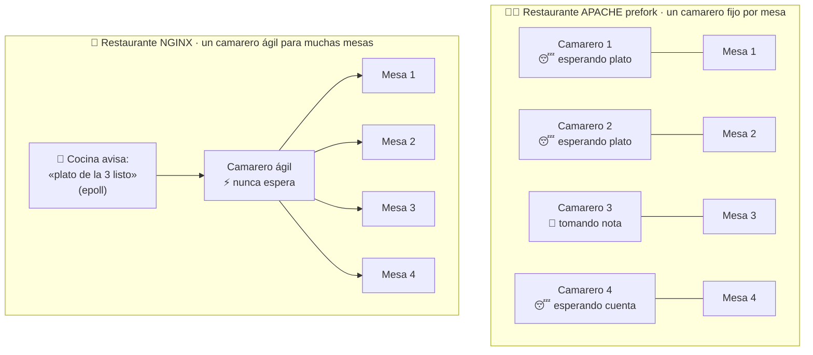

Esa campanita es **`epoll`**, un mecanismo del kernel de Linux que permite a un programa preguntar
"¿hay alguna de estas mil conexiones con datos nuevos?" de forma muy eficiente, en vez de revisarlas
una a una. Así, mientras algo es lento (el disco, la red, el backend), el *worker* de Nginx atiende a
otros clientes:

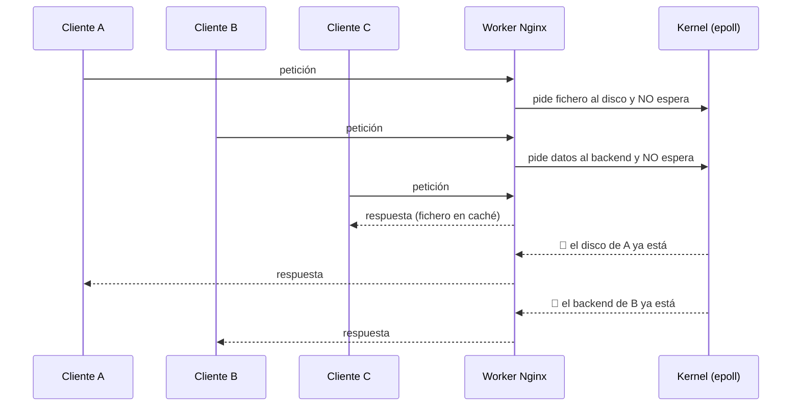

!!! question "¿Y el MPM `event` de Apache que vimos en UD2? ¿No hace lo mismo?"
    Solo en parte. `event` delega las conexiones **en espera** (*keep-alive*) a un hilo que escucha,
    pero cada petición **activa** sigue ocupando un hilo entero hasta que termina, aunque esté parado
    esperando al disco o a la red. Nginx no ata nunca un hilo a una petición.

### 1.3 Un master y pocos workers

Al arrancar Nginx verás varios procesos con dos papeles distintos:

- El **master** es el jefe: arranca como `root`, lee la configuración, abre los puertos 80 y 443 y
  crea a los *workers*. **No atiende clientes.**
- Los **workers** son los camareros ágiles. Trabajan como un usuario sin privilegios (`www-data` en
  Debian/Ubuntu) y cada uno atiende miles de conexiones. Normalmente hay uno por núcleo de CPU.

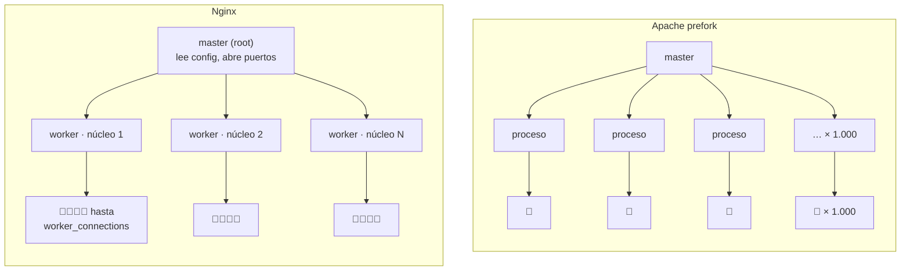

Dos directivas de `/etc/nginx/nginx.conf` controlan la capacidad:

- `worker_processes auto;` → tantos workers como núcleos.
- `worker_connections 768;` (dentro de `events {}`) → conexiones simultáneas **por worker**, no por
  servidor. Debian trae 768.

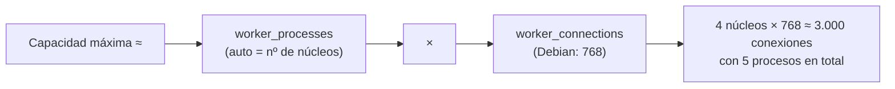

```bash title="Ver el master y los workers" linenums="1"
ps -eo user,cmd | grep [n]ginx      # 1 master (root) + N workers (www-data)
nproc                               # ¿coincide con el número de workers?
grep -n worker /etc/nginx/nginx.conf
```

¿Por qué el master es `root` y los workers no? Hace falta `root` para abrir puertos por debajo de
1024, pero los procesos que hablan con Internet van sin privilegios: si alguien compromete un worker,
no obtiene `root` (principio de **mínimo privilegio**, que verás en SAD). ¿Y por qué no poner 100
workers en una máquina de 4 núcleos? Porque solo 4 se ejecutan a la vez: el resto esperaría turno y
añadiría cambios de contexto. Más workers no significa más velocidad.

### 1.4 Server blocks: varios sitios en un mismo Nginx

El bloque `server {}` de Nginx es el `<VirtualHost>` de Apache: misma función, otra sintaxis. Esta
"piedra Rosetta" te sirve para traducir todo lo que hiciste en UD2:

| Apache (UD2) | Nginx |
|---|---|
| `<VirtualHost *:443>` | `server { listen 443 ssl; }` |
| `ServerName` + `ServerAlias` | `server_name a.com www.a.com;` |
| `DocumentRoot` | `root` |
| `DirectoryIndex` | `index` |
| `SSLCertificateFile` / `SSLCertificateKeyFile` | `ssl_certificate` / `ssl_certificate_key` |
| `a2ensite sitio` | `ln -s /etc/nginx/sites-available/sitio /etc/nginx/sites-enabled/` |
| `apache2ctl configtest` | `nginx -t` |
| `systemctl reload apache2` | `systemctl reload nginx` (o `nginx -s reload`) |
| `.htaccess` por carpeta | ❌ no existe: todo va en la configuración central |

**Una sola cosa no existe en Nginx: el `.htaccess`.** Nginx no busca configuración en cada carpeta
en cada petición, y esa es una de las razones de que sea tan rápido. La otra cara es que en un
*hosting* compartido el cliente no puede tocar su configuración: tiene que pedírselo al
administrador.

Para elegir qué `server` responde, Nginx sigue la misma lógica que la resolución de VirtualHosts de
UD2:

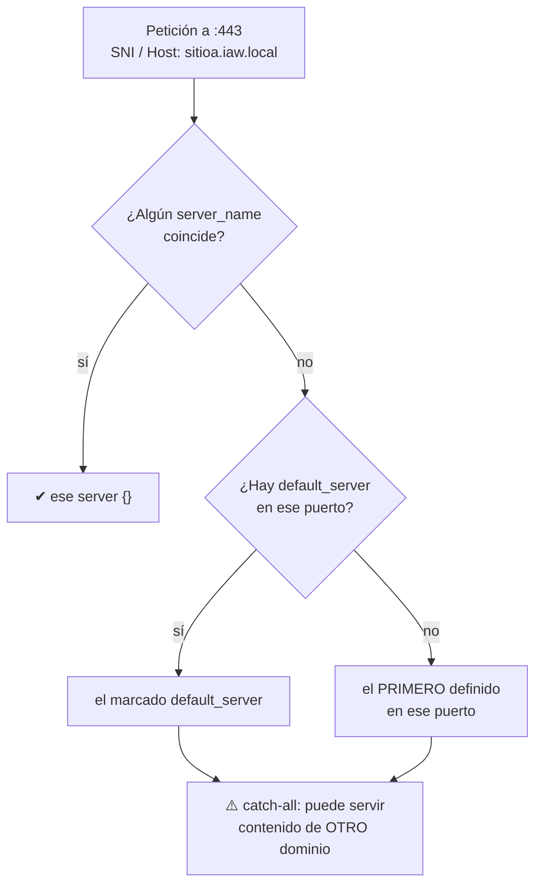

!!! warning "Cada puerto se busca por separado"
    Si `sitioa.iaw.local` solo tiene `listen 443`, una visita a `http://sitioa.iaw.local/` (puerto
    80) no encuentra su `server_name` y la atiende el `default_server` del 80: el usuario ve **otro
    sitio**. Por eso cada sitio HTTPS lleva un segundo `server` en el 80 que solo redirige
    (`return 301 https://…`).

---

## ⭐ 2. El proxy inverso

### 2.1 ¿Qué es un proxy? Directo frente a inverso

Un **proxy** es un intermediario: alguien que habla en nombre de otro. Hay dos tipos, y se
distinguen por **a quién protege y a quién oculta**:

- El **proxy directo** está del lado de los **clientes**. Es el del instituto: tus peticiones pasan
  por él para salir a Internet, decide si puedes entrar en una web y, ante Internet, todos salís con
  la misma IP.
- El **proxy inverso** está del lado de los **servidores**. El cliente cree que habla con
  `tienda.com`, pero en realidad habla con Nginx, que decide a qué servidor interno pasar la
  petición. El cliente no sabe si detrás hay un Apache, tres o una aplicación en Python.

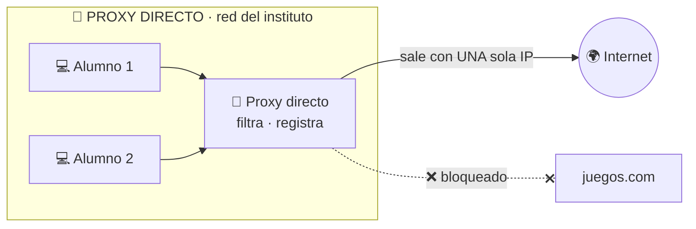

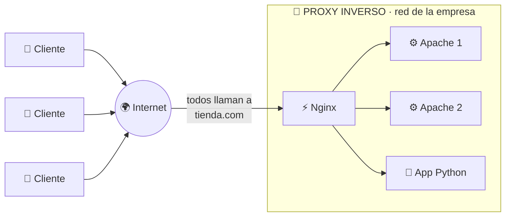

| | Proxy directo | Proxy inverso |
|---|---|---|
| Trabaja para… | los clientes (para **salir**) | los servidores (para **entrar**) |
| Oculta a… | los clientes | los servidores |
| Ejemplo | el proxy del instituto | Nginx delante de una tienda online |

Técnicamente pueden ser el mismo programa (Squid, por ejemplo, puede hacer de los dos): lo que cambia
es **para quién trabaja**. Una analogía útil para el inverso es la **recepción de un hotel**: el
huésped siempre habla con recepción, nunca con cocina o mantenimiento, y no sabe cuántos
departamentos hay ni dónde están.

### 2.2 Las cinco funciones de un proxy inverso

¿Por qué poner un intermediario, si parece un paso de más? Porque hace cinco cosas útiles a la vez:

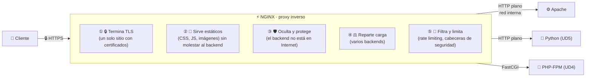

1. **Termina TLS.** Nginx descifra la conexión. Los certificados y las claves privadas viven en
   **un solo sitio**, y los backends ni se enteran de HTTPS. Si tienes diez aplicaciones, no repartes
   la clave privada por diez máquinas.
2. **Sirve los estáticos.** Un CSS no necesita PHP ni Python. Nginx lo sirve directamente, que es lo
   que mejor hace, y el backend solo trabaja en lo dinámico.
3. **Oculta y protege.** El backend no tiene IP pública: para atacarlo hay que pasar antes por Nginx.
4. **Reparte la carga.** Si un Apache no da abasto, se pone otro y Nginx reparte. El cliente no nota
   nada.
5. **Filtra.** Límites de peticiones, cabeceras de seguridad, bloqueos: se aplican en un punto y
   protegen todo lo que hay detrás.


Que Nginx hable con el backend en HTTP sin cifrar es aceptable cuando la red interna es de confianza
(la misma máquina o una red privada): se llama ***TLS termination*** y es muy habitual. Si la red
interna no es de fiar, Nginx puede volver a cifrar hacia el backend (`proxy_pass https://…`).

!!! note "Error típico"
    Creer que un proxy inverso solo sirve para balancear. Con **un solo** backend ya aporta las
    funciones ①, ②, ③ y ⑤.

### 2.3 El viaje de una petición: dos conexiones distintas

Esta es la idea que explica todo lo demás: entre el cliente y el backend hay **dos conexiones**, y la
segunda es **nueva** y la abre Nginx.

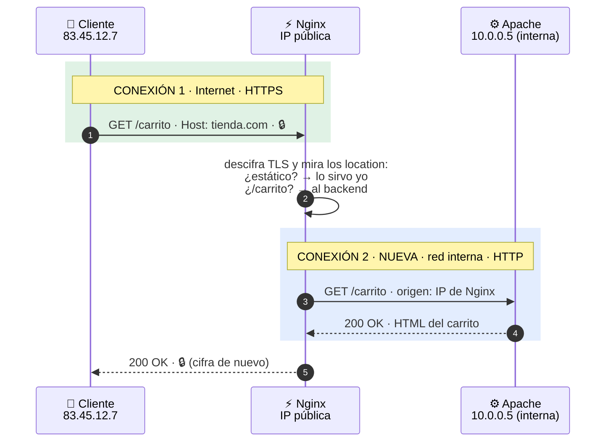

Para Apache, quien le llama es Nginx, no el cliente. La decisión del paso 3 (servir o reenviar) la
toman los bloques `location`, que verás en el punto 3.

### 2.4 Lo que el backend deja de ver (y cómo se arregla)

Como la segunda conexión la abre Nginx, sin nada más el backend cree que **todas** las peticiones
vienen de Nginx, por HTTP y para `127.0.0.1`. Es como si Nginx metiera la carta del cliente en un
sobre **nuevo** con su propio remite. La solución es que Nginx pegue una "nota" a la petición:
cabeceras HTTP adicionales con los datos originales.

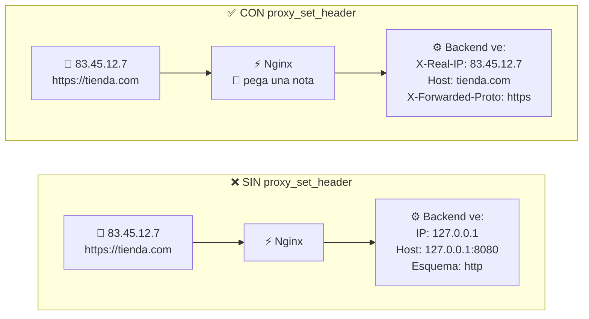

| Cabecera | Qué le cuenta al backend | Qué se rompe si falta |
|---|---|---|
| `Host $host` | El dominio que pidió el cliente | VirtualHosts del backend, y enlaces o redirecciones generados con `127.0.0.1` |
| `X-Real-IP $remote_addr` | La IP real del cliente | Logs inútiles (todo `127.0.0.1`), bloqueos por IP, geolocalización |
| `X-Forwarded-For $proxy_add_x_forwarded_for` | La cadena de IPs si hay varios proxies | Igual que la anterior cuando hay más de un proxy |
| `X-Forwarded-Proto $scheme` | Si el cliente vino por HTTPS | Bucles de redirección "a HTTPS" infinitos y cookies `Secure` que no funcionan |

Las `X-Forwarded-*` no son un estándar oficial, sino una convención que entiende casi todo el
software; la versión estandarizada es la cabecera `Forwarded` (RFC 7239).

!!! danger "El bucle de redirecciones (muy real)"
    Sin `X-Forwarded-Proto`, una aplicación que fuerza HTTPS cree que el cliente vino por HTTP y le
    redirige a HTTPS. El cliente vuelve, Nginx pasa otra vez la petición por HTTP y la aplicación
    vuelve a redirigir: bucle infinito (`ERR_TOO_MANY_REDIRECTS`). Pasa muchísimo con WordPress
    detrás de un proxy.

!!! warning "Cualquiera puede escribir la nota"
    Un atacante puede mandar su propio `X-Forwarded-For` falso. Por eso el backend solo debe fiarse
    de esa cabecera cuando la petición viene **del proxy**. En Apache se hace con `mod_remoteip`:
    `RemoteIPHeader X-Forwarded-For` y `RemoteIPInternalProxy 127.0.0.1`.

---

## ⚙️ 3. Instalación y Configuración

### 3.1 Instalación y estructura de ficheros

```bash title="Instalación en Debian/Ubuntu" linenums="1"
sudo apt update && sudo apt install -y nginx
nginx -v          # Debian 13: nginx/1.26 · Ubuntu 24.04: nginx/1.24
systemctl status nginx
```

El paquete de Debian/Ubuntu organiza la configuración igual que Apache en UD2:

| Ruta | Para qué sirve |
|---|---|
| `/etc/nginx/nginx.conf` | Configuración global: *workers*, `events {}` y el bloque `http {}` |
| `/etc/nginx/conf.d/*.conf` | Se incluyen **dentro de `http {}`**: solo directivas de ese nivel (zonas de `limit_req`, `log_format`, `gzip_types`…) |
| `/etc/nginx/sites-available/` | Un fichero por sitio (bloques `server {}`) |
| `/etc/nginx/sites-enabled/` | Los sitios activos. No hay `a2ensite`: se activan con un enlace simbólico |
| `/etc/nginx/snippets/` | Trozos de configuración reutilizables (`include snippets/…;`) |
| `/var/log/nginx/` | `access.log` y `error.log` |

!!! note "¿Y el repositorio oficial de nginx.org?"
    Si necesitas la última versión, nginx.org tiene su propio repositorio. Ten en cuenta que esos
    paquetes no traen `sites-available`/`sites-enabled`: todo va en `conf.d/`. En clase usamos el
    paquete de la distribución.

### 3.2 Dónde va cada directiva: los contextos

La configuración de Nginx son bloques dentro de bloques, y cada directiva solo se puede escribir en
ciertos bloques (**contextos**). Es la causa de los dos errores más frecuentes:

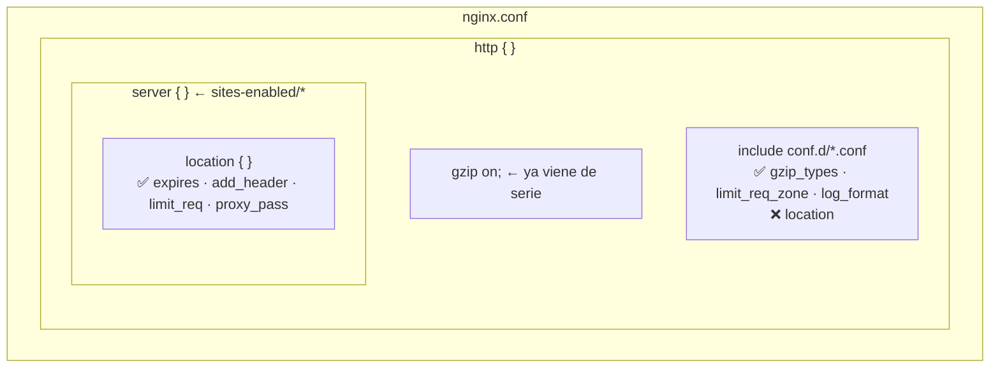

| Error de `nginx -t` | Causa |
|---|---|
| `"location" directive is not allowed here` | Un `location` en `conf.d/`, que está en el nivel `http`. Los `location` van dentro de un `server {}` |
| `"gzip" directive is duplicate` | Has escrito `gzip on;` en `conf.d/`, pero el `nginx.conf` de Debian/Ubuntu ya lo trae |

```bash title="El ciclo de cualquier cambio" linenums="1"
sudo nginx -t                      # valida la sintaxis SIN aplicar nada
sudo systemctl reload nginx        # aplica sin cortar las conexiones activas
sudo nginx -T | less               # muestra la configuración COMPLETA ya ensamblada
```

`nginx -t` es una disciplina, no una sugerencia. Con `reload`, si la configuración nueva tiene un
error, el master lo detecta y **sigue con la configuración vieja**: la web no cae, pero el cambio no
se aplica, y si no miras el log no te enteras. Con `restart`, en cambio, el servicio puede quedarse
caído.

### 3.3 Un sitio estático con HTTPS

```nginx title="/etc/nginx/sites-available/sitioa.conf" linenums="1"
server {
    listen 80;
    server_name sitioa.iaw.local www.sitioa.iaw.local;
    return 301 https://$host$request_uri;      # 80 → 443
}

server {
    listen 443 ssl;
    http2 on;                                  # Nginx >= 1.25.1. En la 1.24: listen 443 ssl http2;
    server_name sitioa.iaw.local www.sitioa.iaw.local;

    ssl_certificate     /etc/ssl/lab/lab.crt;  # el certificado de UD1/UD2
    ssl_certificate_key /etc/ssl/lab/lab.key;
    ssl_protocols TLSv1.3 TLSv1.2;

    root  /var/www/sitioa;
    index index.html;

    access_log /var/log/nginx/sitioa_access.log;   # un log por sitio
    error_log  /var/log/nginx/sitioa_error.log;

    location / {
        try_files $uri $uri/ =404;             # el fichero, la carpeta o 404
    }
}
```

```bash title="Activarlo y probarlo" linenums="1"
sudo ln -s /etc/nginx/sites-available/sitioa.conf /etc/nginx/sites-enabled/
sudo nginx -t && sudo systemctl reload nginx
curl -I  http://sitioa.iaw.local/      # 301 → https://sitioa.iaw.local/
curl -kI https://sitioa.iaw.local/     # 200 (-k: acepta el certificado autofirmado)
```

!!! danger "`listen 443 ssl` necesita certificado"
    Sin `ssl_certificate` y `ssl_certificate_key`, `nginx -t` falla con `no "ssl_certificate" is
    defined for the "listen ... ssl" directive`.

### 3.4 `proxy_pass`: Nginx delante de una aplicación

Tres directivas responden a tres preguntas:

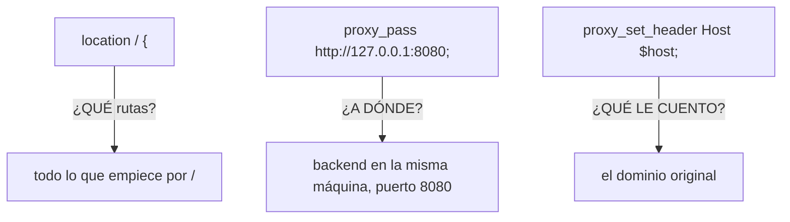

```nginx title="/etc/nginx/sites-available/app.conf (HTTP, para entender proxy_pass)" linenums="1"
server {
    listen 80;
    server_name app.iaw.local;

    location / {
        proxy_pass http://127.0.0.1:8080;
        proxy_set_header Host              $host;
        proxy_set_header X-Real-IP         $remote_addr;
        proxy_set_header X-Forwarded-For   $proxy_add_x_forwarded_for;
        proxy_set_header X-Forwarded-Proto $scheme;
    }
}
```

Si comentas las cuatro `proxy_set_header` y miras qué recibe el backend, verás exactamente lo del
punto 2.4: `Host: 127.0.0.1:8080` (ha perdido el dominio) y ninguna IP del cliente. Al
descomentarlas, el backend recibe `Host: app.iaw.local` y tu IP real.

Un mismo `server` puede tener varios `location`: unas rutas las sirve Nginx del disco y otras van al
backend.

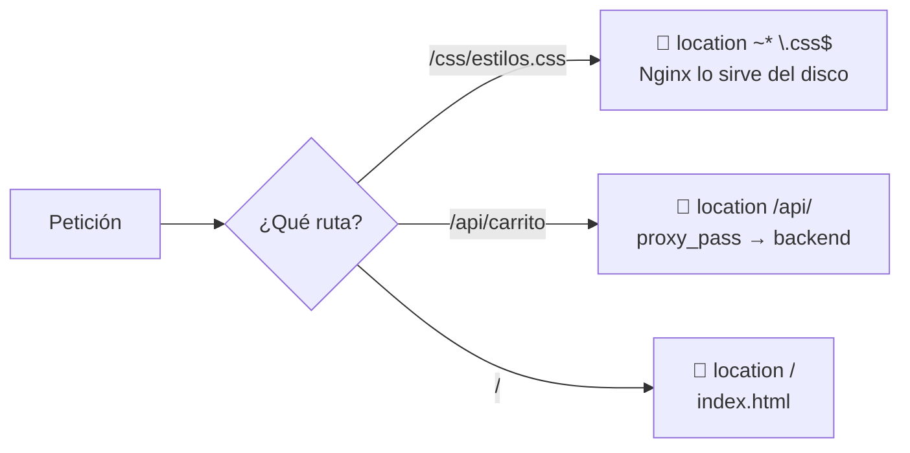

| `location` | Qué rutas atrapa |
|---|---|
| `location / { }` | Todas (es el prefijo más corto: se usa si no hay otro mejor) |
| `location /api/ { }` | Las que empiezan por `/api/` |
| `location ~* \.(css\|js)$ { }` | Expresión regular (`~*` = sin distinguir mayúsculas): las que acaban en `.css` o `.js` |
| `location = /login { }` | Exactamente `/login` |

!!! warning "La barra final de `proxy_pass` cambia la ruta"
    Dentro de `location /api/`, `proxy_pass http://127.0.0.1:8080;` (sin barra) reenvía
    `/api/carrito` tal cual, mientras que `proxy_pass http://127.0.0.1:8080/;` (con barra) **quita**
    el `/api/` y reenvía `/carrito`.

!!! info "Apache y Nginx en la misma máquina"
    Solo un programa puede escuchar en cada puerto. Si el Apache de UD2 sigue en el 80/443, Nginx no
    arranca (`Address already in use`). Para ponerlo detrás de Nginx, en `/etc/apache2/ports.conf`
    cambia a `Listen 127.0.0.1:8080`, pasa su VirtualHost a `<VirtualHost *:8080>` sin TLS (el
    cifrado lo hace ahora Nginx), desactiva el sitio del 443 y reinicia Apache.

### 3.5 Repartir la carga entre varios backends: `upstream`

Con un bloque `upstream` se agrupan varios backends con un nombre, y `proxy_pass` apunta a ese
nombre. Por defecto Nginx reparte por turnos (*round robin*).

```nginx title="/etc/nginx/sites-available/tienda.conf" linenums="1"
upstream apaches {
    zone apaches 64k;          # estado compartido entre los workers
    server 10.0.0.5:80;
    server 10.0.0.6:80;
}

server {
    listen 80;
    server_name tienda.iaw.local;

    location / {
        proxy_pass http://apaches;
        proxy_set_header Host              $host;
        proxy_set_header X-Real-IP         $remote_addr;
        proxy_set_header X-Forwarded-For   $proxy_add_x_forwarded_for;
        proxy_set_header X-Forwarded-Proto $scheme;
    }
}
```

```bash title="Comprobar el reparto" linenums="1"
for i in 1 2 3 4; do curl -s http://tienda.iaw.local/ | grep -o "APACHE [12]"; done
# APACHE 1 · APACHE 2 · APACHE 1 · APACHE 2
```

- **`zone apaches 64k;`**: sin esta línea cada worker lleva su propio turno. Con muchos workers y
  pocas peticiones casi siempre responde el primer backend y parece que el balanceo no funciona: es
  un buen ejemplo de que **cada worker es independiente**.
- **Si un backend se cae**: con un solo backend el cliente ve `502 Bad Gateway` (Nginx no consigue
  respuesta del de detrás); con dos, Nginx manda las peticiones al que sigue vivo. El balanceo en
  profundidad (HAProxy) lo verás en SAD.

### 3.6 Caché de estáticos y compresión gzip

Son **dos ahorros distintos**:

- La **caché** (`expires` → cabecera `Cache-Control`) le dice al navegador "este fichero no cambia en
  30 días, no me lo vuelvas a pedir". La mejor petición es la que no se hace.
- **gzip** comprime lo que sí se envía. El texto (CSS, JS, HTML, JSON, SVG) se comprime muchísimo;
  las imágenes JPG o PNG no, porque ya van comprimidas.

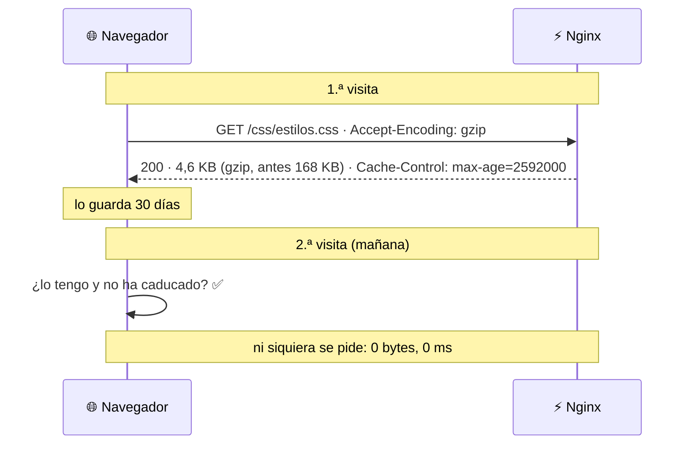

| `estilos.css` del laboratorio | Bytes transferidos |
|---|---|
| Sin gzip | 168.477 (~168 KB) |
| Con gzip | 4.622 (~4,6 KB, **36 veces menos**) |
| 2.ª visita, en caché | 0 |

El `nginx.conf` de Debian/Ubuntu ya trae `gzip on;`, pero **solo comprime `text/html`**. Hay que
añadir los demás tipos, y eso va en el nivel `http`:

```nginx title="/etc/nginx/conf.d/gzip.conf (contexto http)" linenums="1"
# NO escribas "gzip on;" aquí: ya está en nginx.conf → "gzip" directive is duplicate
gzip_types text/css application/javascript image/svg+xml application/json;
gzip_min_length 1024;      # no merece la pena comprimir ficheros muy pequeños
gzip_vary on;              # avisa a las cachés intermedias (Vary: Accept-Encoding)
```

La caché se pone en un `location` que solo atrape **ficheros estáticos**:

```nginx title="Dentro del server {}" linenums="1"
location ~* \.(css|js|jpg|jpeg|png|gif|svg|webp|woff2?)$ {
    expires 30d;               # genera Cache-Control: max-age=2592000
    access_log off;
}
```

```bash title="Medir antes y después" linenums="1"
curl -sk -o /dev/null -w "%{size_download} bytes\n" -H "Accept-Encoding: gzip" https://sitioa.iaw.local/css/estilos.css
curl -skI https://sitioa.iaw.local/css/estilos.css | grep -i cache-control
```

!!! danger "Caché en contenido dinámico = desastre"
    La caché es **solo** para lo estático. Si se cachea una página personal, el siguiente usuario
    puede ver los datos del anterior, o datos desactualizados. Las rutas dinámicas deben responder
    con `Cache-Control: no-store`, y la expresión regular de los estáticos no debe atrapar rutas del
    backend.

    ```mermaid
    flowchart LR
        A["👩 Ana pide /mi-cuenta"] --> P["Proxy/caché"] --> B["⚙️ Backend:<br/>«Hola Ana, saldo 1.200 €»"]
        P -->|"guarda la respuesta"| K[("caché")]
        J["👨 Juan pide /mi-cuenta"] --> P
        K -->|"😱 «Hola Ana, saldo 1.200 €»"| J
    ```

!!! warning "La trampa de `add_header`"
    Un `add_header` dentro de un `location` **anula todos** los `add_header` del `server`. Si pones
    `X-Frame-Options` o HSTS en el `server` y `add_header Cache-Control …` en el `location` de los
    CSS, **los CSS se sirven sin cabeceras de seguridad**. Soluciones: no usar `add_header` en ese
    `location` (`expires` ya genera el `Cache-Control`), o repetir las cabeceras con un
    `include snippets/…;` en cada `location` que tenga su propio `add_header` (lo verás en el punto
    3.8). Pasa lo mismo con `proxy_set_header`.

    ```mermaid
    flowchart LR
        S["server {<br/>add_header X-Frame-Options …;"] --> L1["location / { }<br/>✅ hereda X-Frame-Options"]
        S --> L2["location ~* \.css$ {<br/>add_header Cache-Control …; }<br/>❌ X-Frame-Options DESAPARECE"]
    ```

### 3.7 Ajustes de rendimiento

Cuatro ajustes, y cada uno ahorra un trabajo concreto:

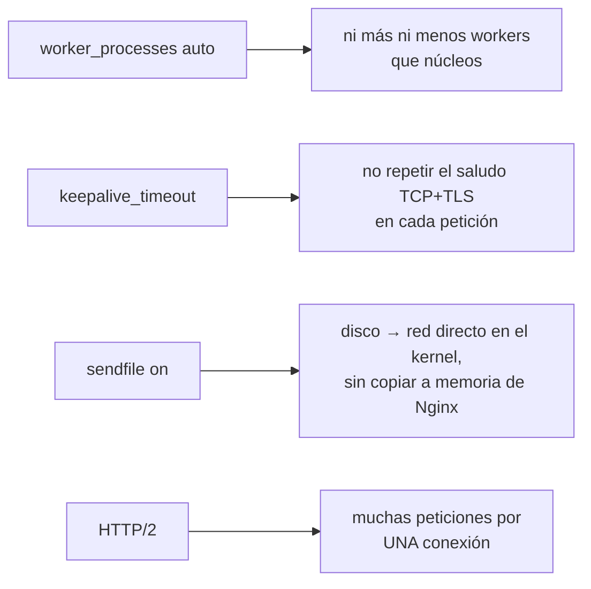

```bash title="¿Qué trae ya Debian?" linenums="1"
grep -nE "worker_processes|sendfile|keepalive" /etc/nginx/nginx.conf
curl -sk -o /dev/null -w "%{http_version}\n" https://sitioa.iaw.local/   # 2 si HTTP/2 está activo
```

**`sendfile`** evita copias: el kernel manda el fichero del disco a la red sin pasar por la memoria
de Nginx.

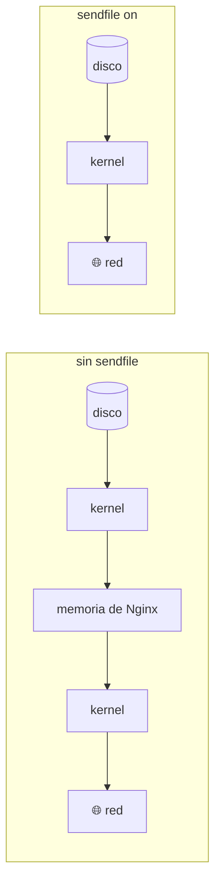

**HTTP/2** (lo viste en UD1) multiplexa: muchos recursos viajan en paralelo por **una** sola
conexión, sin abrir seis conexiones ni esperar uno detrás de otro.

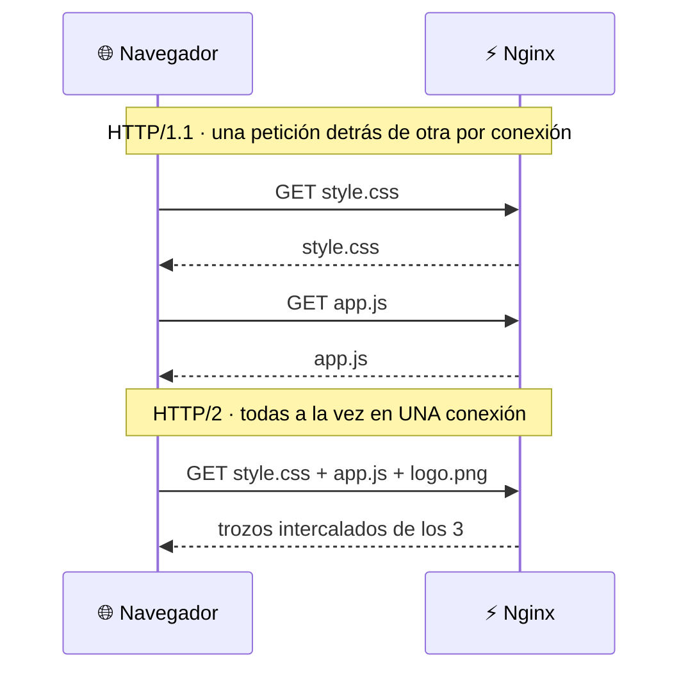

!!! warning "Versión de Nginx y HTTP/2"
    `http2 on;` solo existe desde Nginx **1.25.1** (Debian 13 trae la 1.26). En Ubuntu 24.04 (1.24)
    se escribe `listen 443 ssl http2;`. Si `nginx -t` da `unknown directive "http2"`, es eso:
    compruébalo con `nginx -v`.

### 3.8 Todo junto: un frontend HTTPS completo

Este `server` reúne todo lo anterior: redirección a HTTPS, TLS con HTTP/2, cabeceras de seguridad,
estáticos con caché y el resto de la aplicación detrás de Nginx.

```nginx title="/etc/nginx/snippets/cabeceras-seguridad.conf" linenums="1"
add_header Strict-Transport-Security "max-age=63072000; includeSubDomains" always;
add_header X-Content-Type-Options "nosniff" always;
add_header X-Frame-Options "SAMEORIGIN" always;
```

```nginx title="/etc/nginx/sites-available/app-segura.conf" linenums="1"
server {
    listen 80;
    server_name app.iaw.local;
    return 301 https://$host$request_uri;
}

server {
    listen 443 ssl;
    http2 on;
    server_name app.iaw.local;

    ssl_certificate     /etc/ssl/lab/lab.crt;
    ssl_certificate_key /etc/ssl/lab/lab.key;
    ssl_protocols TLSv1.3 TLSv1.2;
    ssl_session_cache shared:SSL:10m;

    include snippets/cabeceras-seguridad.conf;

    # Cabeceras para el backend: puestas a nivel de server, las heredan los location
    proxy_set_header Host              $host;
    proxy_set_header X-Real-IP         $remote_addr;
    proxy_set_header X-Forwarded-For   $proxy_add_x_forwarded_for;
    proxy_set_header X-Forwarded-Proto $scheme;

    # Estáticos: los sirve Nginx con caché larga (sin add_header: heredan las de seguridad)
    location /static/ {
        alias /var/www/app/static/;
        expires 30d;
        access_log off;
    }

    # Todo lo demás: al backend, sin caché
    location / {
        proxy_pass http://127.0.0.1:8080;
        include snippets/cabeceras-seguridad.conf;   # tiene su propio add_header: hay que repetirlas
        add_header Cache-Control "no-store" always;
    }
}
```

`alias` y `root` no son lo mismo: `root /var/www/app;` **añade** la URI completa
(`/static/logo.png` → `/var/www/app/static/logo.png`), mientras que `alias` **sustituye** la parte
que coincide con el `location` (`location /static/ { alias /var/www/app/static/; }` → la misma ruta).
Error común: poner la barra final en uno y no en el otro.

!!! danger "HSTS con un certificado autofirmado"
    Con `Strict-Transport-Security`, el navegador recuerda durante `max-age` segundos que ese dominio
    solo va por HTTPS y **ya no deja aceptar el aviso** del certificado autofirmado. En el laboratorio
    usa un valor corto (`max-age=300`) o pruébalo solo con `curl`; el valor de dos años es para
    producción con un certificado válido.

---

## 🛠️ 4. Laboratorio Práctico Dirigido: frontend Nginx completo

Objetivo: juntar en un solo `server` todo lo de la unidad: TLS, estáticos con caché y gzip, proxy
hacia el backend y medición.

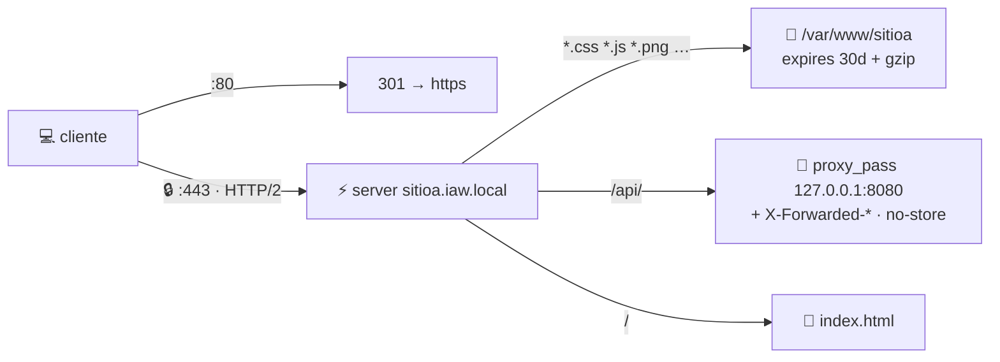

Antes de empezar necesitas:

- El certificado de UD1/UD2 en `/etc/ssl/lab/lab.crt` y `lab.key`.
- Un backend escuchando en `127.0.0.1:8080` (por ejemplo, el Apache de UD2 movido a ese puerto).
- Que los dominios apunten a tu máquina: `127.0.0.1 sitioa.iaw.local app.iaw.local` en `/etc/hosts`.

| # | Paso | Cómo lo compruebo |
|---|---|---|
| 1 | `server` con TLS y redirección 80 → 443 | `curl -kI https://sitioa.iaw.local/` → `200`; `curl -I http://sitioa.iaw.local/` → `301` |
| 2 | Estáticos con caché y gzip | `curl -kI …/css/estilos.css` → `Cache-Control: max-age=…`; con `-H "Accept-Encoding: gzip"` → `Content-Encoding: gzip` |
| 3 | `/api/` al backend | `curl -k …/api/x` → el backend ve `Host: sitioa.iaw.local` y `X-Forwarded-Proto: https` |
| 4 | Medir | `curl -w "%{size_download}"` con y sin `Accept-Encoding: gzip` |
| 5 | Validar la caché | `curl -kI` en un estático (con `max-age`) y en `/api/` (`no-store`, sin `max-age`) |

```bash title="Comprobaciones finales" linenums="1"
curl -skI -H "Accept-Encoding: gzip" https://sitioa.iaw.local/css/estilos.css | grep -iE "encoding|cache"
curl -skI https://sitioa.iaw.local/api/x | grep -i cache      # NO debe tener max-age
curl -sk -o /dev/null -w "%{http_version}\n" https://sitioa.iaw.local/   # 2
```

!!! example "Mini-reto (en parejas)"
    Sin mirar la guía: haz que el backend reciba **tu IP real** y que el CSS llegue **comprimido y
    cacheado**, mientras `/api/` **no** se cachea. El error más común es una expresión regular de
    estáticos tan amplia que también atrapa rutas dinámicas. Antes de dar por bueno el resultado,
    explica señalando tus `location` qué ruta va al backend y cuál no.

!!! tip "Si algo falla"
    * `502 Bad Gateway`: Nginx funciona, pero no hay nada en el backend. Compruébalo con
      `ss -tlnp | grep 8080`.
    * `Address already in use`: otro programa (¿Apache?) ocupa el 80 o el 443.
    * `"location" directive is not allowed here`: has puesto un `location` fuera de un `server {}`.
    * Los CSS llegan sin HSTS: la trampa de `add_header` (punto 3.6).
    * El error exacto, con fichero y línea, está en `/var/log/nginx/error.log`.

---

## 🛡️ 5. Seguridad, Límites, Logs y Diagnóstico

### 5.1 Límite de peticiones: el cubo que gotea

`limit_req` funciona como un **cubo con un agujero**: deja pasar un ritmo fijo de peticiones por IP,
admite una pequeña ráfaga y rechaza el resto. Es el equivalente a `mod_evasive` de UD2 y mitiga
ataques de fuerza bruta y *DoS* de capa 7 sin cargar al backend.

```mermaid
flowchart TB
    IN["🚿 peticiones de UNA IP<br/>(a chorro)"] --> CUBO["🪣 cubo de burst<br/>(margen de ráfaga)"]
    CUBO -->|"💧 sale al ritmo de rate"| OK["✅ al backend"]
    IN -.->|"cubo lleno"| NO["⛔ 429 Too Many Requests"]
```

Se define en **dos sitios**, porque cada directiva va en un contexto distinto:

```nginx title="/etc/nginx/conf.d/limites.conf (contexto http)" linenums="1"
limit_req_zone $binary_remote_addr zone=general:10m rate=10r/s;
limit_req_zone $binary_remote_addr zone=login:10m   rate=10r/m;
limit_req_status 429;
```

```nginx title="Dentro del server {}" linenums="1"
location /api/ {
    limit_req zone=general burst=20 nodelay;
    proxy_pass http://127.0.0.1:8080;
}

location /login {
    limit_req zone=login burst=5 nodelay;
    proxy_pass http://127.0.0.1:8080;
}
```

- `rate=10r/m` en `/login` es una petición cada 6 segundos por IP. Con `burst=5 nodelay` se
  atienden al momento 5 más: quien se equivoca un par de veces no nota nada, pero un script que
  prueba contraseñas recibe enseguida `429`. Así se limita **un endpoint** sin afectar al resto.
- `limit_req_status 429`: sin esta línea Nginx responde `503 Service Unavailable`, que confunde porque
  parece que el servidor está caído.
- `$binary_remote_addr` en vez de `$remote_addr`: ocupa menos (4 bytes en IPv4), así que caben más IPs
  en los 10 MB de la zona.

```bash title="Comprobarlo con carga (paquete apache2-utils)" linenums="1"
ab -k -n 60 -c 20 https://sitioa.iaw.local/api/x | grep -E "Complete|Non-2xx"
# Complete requests: 60 · Non-2xx responses: 39   → se han cortado 39
tail -3 /var/log/nginx/sitioa_error.log      # limiting requests, excess: … by zone "general"
```

Bloquear IPs a mano no escala; `limit_req` es dinámico y basado en tasa. Complementa (no sustituye)
a un WAF o a fail2ban, que bloquean de forma persistente a quien supera un umbral.

### 5.2 Logs personalizados: `$request_time`

El código `200` dice **si** funcionó; `$request_time` dice **cuánto tardó**. Una web puede ir mal
devolviendo solo `200`.

```nginx title="/etc/nginx/conf.d/logs.conf (contexto http)" linenums="1"
log_format tiempos '$remote_addr - [$time_local] "$request" $status '
                   '$body_bytes_sent rt=$request_time urt=$upstream_response_time '
                   'host=$host';
```

```nginx title="Dentro del server {}" linenums="1"
access_log /var/log/nginx/sitioa_access.log tiempos;
```

```mermaid
sequenceDiagram
    participant C as Cliente
    participant N as Nginx
    participant B as Backend
    C->>N: petición
    activate N
    N->>B: proxy_pass
    activate B
    Note right of B: $upstream_response_time<br/>(lo que tarda el backend)
    B-->>N: respuesta
    deactivate B
    N-->>C: respuesta
    deactivate N
    Note left of N: $request_time<br/>(todo, de principio a fin)
```

```text title="Una línea del log"
"GET /api/lento HTTP/2.0" 200 276 rt=2.001 urt=2.002   → 200 OK… ¡pero 2 segundos!
```

- Si `rt` y `urt` son casi iguales, el lento es el **backend**.
- Si `rt` es mucho mayor que `urt`, el problema está en la red o en el cliente.
- **Un log por sitio** (`access_log` dentro de cada `server`) permite diagnosticar un dominio sin
  buscar entre el tráfico de todos.
- Con `log_format … escape=json` se escriben en JSON, el formato recomendado para enviarlos a un
  SIEM (lo verás en SAD). Para verlos de forma rápida, `goaccess access.log`.

### 5.3 Capacidad: `worker_connections` y descriptores de fichero

```nginx title="/etc/nginx/nginx.conf (extracto)" linenums="1"
worker_processes auto;          # un worker por núcleo de CPU
worker_rlimit_nofile 65535;     # descriptores de fichero que puede abrir cada worker

events {
    worker_connections 4096;    # conexiones simultáneas por worker (Debian trae 768)
}
```

- Como proxy, cada cliente gasta **dos** conexiones (la del cliente y la del backend), así que caben
  la mitad de clientes. Si se quedan cortas, en `error.log` aparece `worker_connections are not
  enough` y se rechazan conexiones con tráfico alto.
- Cada conexión es un descriptor de fichero. `worker_rlimit_nofile` eleva el límite de cada worker (el
  del sistema, `ulimit -n`, suele ser 1024); tiene que ser mayor que `worker_connections` o
  aparecerá `Too many open files`.

### 5.4 Errores comunes y su síntoma

| Error | Síntoma |
|---|---|
| `server_name` mal escrito | Sirve otro sitio (el *catch-all*) |
| Sin gzip | Páginas pesadas, lentas en móvil |
| Sin `proxy_set_header` | Logs del backend con todo `127.0.0.1`, bucles de redirección |
| Caché en contenido dinámico | 😱 Datos de un usuario servidos a otro |
| `worker_connections` bajo | Rechaza conexiones con tráfico alto |
| Sin *keep-alive* | Saludo TCP/TLS repetido en cada petición |
| Un certificado para todo, mal gestionado | Caduca y caen **todos** los sitios a la vez |
| `reload` sin `nginx -t` | El cambio no se aplica (o, con `restart`, el servicio cae) |

### 5.5 Diagnóstico rápido

```mermaid
flowchart TD
    S["😩 «No funciona»"] --> T{"nginx -t"}
    T -- error --> F["lee la línea indicada:<br/>duplicate → ya está en nginx.conf<br/>not allowed here → contexto equivocado<br/>no ssl_certificate → faltan certs"]
    T -- ok --> R{"¿reload hecho?"}
    R -- no --> RL["systemctl reload nginx"]
    R -- sí --> C{"curl -I"}
    C -- "sitio equivocado" --> SN["server_name / default_server"]
    C -- "404" --> RT["root / alias / try_files"]
    C -- "502" --> BK["backend caído o puerto mal<br/>ss -tlnp"]
    C -- "504" --> TO["backend lento (urt= en el log)"]
    C -- "429 / 503" --> LR["limit_req"]
    C -- "bucle de redirecciones" --> XP["falta X-Forwarded-Proto"]
```

| Síntoma | Causa probable |
|---|---|
| `"gzip" directive is duplicate` | `gzip on` ya está en `nginx.conf` |
| `"location" directive is not allowed here` | `location` en `conf.d/` (contexto `http`) |
| `no "ssl_certificate" is defined` | `listen 443 ssl` sin certificado |
| `unknown directive "http2"` | Nginx anterior a la 1.25.1 |
| El backend ve todo `127.0.0.1` | Faltan las `proxy_set_header` |
| CSS sin HSTS ni `X-Frame-Options` | `add_header` en el `location` anula los del `server` |
| El balanceo "no reparte" | `upstream` sin `zone` y muchos workers |
| `502 Bad Gateway` | Backend caído o puerto equivocado |

### 5.6 Nginx en arquitecturas modernas

El patrón del punto 2.2 se repite a gran escala:

```mermaid
flowchart LR
    U["🌍 Usuarios"] --> LB["⚖️ Balanceador<br/>(HAProxy · SAD)"]
    LB --> N1["⚡ Nginx 1"] & N2["⚡ Nginx 2"]
    subgraph K8S["☸️ Kubernetes"]
        IC["Nginx Ingress Controller"] --> P1["contenedor web"] & P2["contenedor api"]
    end
    N1 & N2 --> IC
    LE["🔐 Let's Encrypt<br/>renueva solo"] -.-> N1 & N2
```

Una petición puede atravesar dos o tres proxies inversos (balanceador, Nginx, *Ingress*). Por eso
`X-Forwarded-For` lleva una **lista** de IPs: cada proxy añade la suya
(`$proxy_add_x_forwarded_for`).

### 5.7 Socket Unix frente a TCP

`proxy_pass` no siempre usa la red. Si el backend está en la misma máquina, puede escuchar en un
**socket Unix**, un fichero especial del kernel:

```mermaid
flowchart TB
    subgraph TCP["proxy_pass http://127.0.0.1:8080"]
        a1["Nginx"] --> t1["pila TCP/IP:<br/>puertos · handshake · cabeceras TCP"] --> b1["App"]
    end
    subgraph UNIX["proxy_pass http://unix:/run/app.sock"]
        a2["Nginx"] --> t2["fichero especial del kernel<br/>(sin red)"] --> b2["App"]
    end
```

El socket Unix se salta la pila de red: algo menos de latencia y de CPU, no ocupa puertos y se
controla con **permisos de fichero** (quién puede conectarse). Su limitación es que solo sirve si los
dos programas están en la misma máquina. Lo verás en UD4: PHP-FPM se conecta casi siempre por
`/run/php/php-fpm.sock`.

### 5.8 Chuleta de comandos

```bash title="Nginx en el día a día" linenums="1"
# Ciclo de vida
sudo nginx -t                              # validar SIEMPRE
sudo systemctl reload nginx                # aplicar sin cortar conexiones (= nginx -s reload)
sudo systemctl restart|status nginx
sudo nginx -T | less                       # configuración completa ya ensamblada

# Sitios (no hay a2ensite)
sudo ln -s /etc/nginx/sites-available/X.conf /etc/nginx/sites-enabled/
sudo rm /etc/nginx/sites-enabled/X.conf

# Pruebas
curl -H "Host: dominio" http://localhost/                 # elegir el server sin tocar /etc/hosts
curl -kI https://sitioa.iaw.local/                        # cabeceras
curl -sk -o /dev/null -w "%{size_download}\n" -H "Accept-Encoding: gzip" URL
curl -sk -o /dev/null -w "%{http_version}\n" URL
ab -k -n 60 -c 20 URL                                     # carga / límite de peticiones

# Logs
sudo tail -f /var/log/nginx/access.log /var/log/nginx/error.log
```

---

## ❓ 6. Preguntas y Casos de Autoevaluación

1. **¿Por qué Nginx soporta más conexiones concurrentes con menos RAM que Apache prefork?**
   *Resolución:* Modelo asíncrono orientado a eventos: pocos workers (uno por núcleo) atienden miles
   de conexiones no bloqueantes cada uno, avisados por `epoll`, frente a un proceso con su propia
   memoria por cada conexión.

2. **¿Por qué el proceso master de Nginx se ejecuta como `root` y los workers no?**
   *Resolución:* Hace falta `root` para abrir los puertos 80 y 443, pero los workers son los que
   hablan con Internet: van sin privilegios (`www-data`) para que un worker comprometido no dé acceso
   de `root`.

3. **El proxy del instituto, ¿es directo o inverso? ¿Y Nginx delante de una tienda online?**
   *Resolución:* El del instituto es directo (trabaja para los clientes para salir y los oculta).
   Nginx delante de la tienda es inverso (trabaja para los servidores para recibir y los oculta).

4. **Cita las cinco funciones de un proxy inverso.**
   *Resolución:* Termina TLS, sirve estáticos, oculta y protege el backend, reparte la carga y
   filtra (límites, cabeceras de seguridad).

5. **Los logs del backend muestran siempre la IP del proxy en vez de la del cliente. ¿Causa?**
   *Resolución:* Hay dos conexiones y la segunda la abre Nginx. Faltan las cabeceras
   `X-Real-IP`/`X-Forwarded-For` (`proxy_set_header`), o el backend no está configurado para confiar
   en ellas (en Apache, `mod_remoteip`).

6. **Una aplicación detrás de Nginx entra en un bucle de redirecciones a HTTPS. ¿Qué falta?**
   *Resolución:* `proxy_set_header X-Forwarded-Proto $scheme;`. Sin ella, la aplicación cree que el
   cliente llegó por HTTP y le redirige a HTTPS una y otra vez.

7. **¿Por qué es peligroso cachear contenido dinámico?**
   *Resolución:* Se puede servir a un usuario la página personal de otro, o datos desactualizados.
   La caché es solo para estáticos; lo dinámico va con `Cache-Control: no-store`.

8. **¿Qué ventaja aporta HTTP/2 en un sitio con muchos recursos?**
   *Resolución:* Multiplexación: muchos recursos viajan en paralelo por una sola conexión.

9. **¿Por qué ejecutar `nginx -t` antes de recargar?**
   *Resolución:* Valida la sintaxis sin aplicar nada. Un `reload` con errores no aplica el cambio
   (y un `restart` puede dejar el servicio caído).

10. **`nginx -t` dice `"location" directive is not allowed here in /etc/nginx/conf.d/limites.conf`.
    ¿Qué pasa?**
    *Resolución:* Los ficheros de `conf.d/` se incluyen dentro de `http {}`, y un `location` solo
    puede ir dentro de un `server {}`. La zona (`limit_req_zone`) se queda en `conf.d/`; el
    `location` con `limit_req` va en el fichero del sitio.

11. **Has puesto HSTS en el `server` y `add_header Cache-Control` en el `location` de los CSS. ¿Qué
    les pasa a los CSS?**
    *Resolución:* Se sirven sin HSTS ni el resto de cabeceras de seguridad: un `add_header` en el
    `location` anula todos los del `server`. Hay que repetirlas en ese `location` o usar solo
    `expires`.

12. **¿Qué aporta `$request_time` que el código de estado no revela?**
    *Resolución:* La lentitud: un `200` puede tardar 10 segundos. Comparado con
    `$upstream_response_time` indica si el lento es el backend o la red.

13. **¿Qué diferencia hay entre `alias` y `root`?**
    *Resolución:* `root` añade la URI completa a la ruta base; `alias` sustituye la parte de la URI
    que coincide con el `location`.

14. **¿Qué relación hay entre `worker_connections` y `worker_rlimit_nofile`?**
    *Resolución:* `worker_connections` fija cuántas conexiones atiende cada worker; cada conexión es un
    descriptor de fichero, y `worker_rlimit_nofile` es el límite de descriptores del worker. El
    segundo debe ser mayor que el primero; como proxy, cada cliente usa dos conexiones.

15. **¿Qué ventaja tiene un socket Unix frente a `127.0.0.1:puerto`, y cuándo no se puede usar?**
    *Resolución:* Se salta la pila TCP/IP (menos latencia y CPU), no ocupa puertos y se protege con
    permisos de fichero. Solo funciona si Nginx y el backend están en la misma máquina.

!!! success "Resumen de la unidad"
    * Nginx es **orientado a eventos**: un master y pocos workers, cada uno con miles de conexiones.
    * Un **server block** es un VirtualHost; no existe `.htaccess`.
    * Un **proxy inverso termina TLS, sirve estáticos, oculta, reparte y filtra**.
    * Hay **dos conexiones**: sin `proxy_set_header`, el backend pierde IP, dominio y esquema.
    * **Caché solo para estáticos**; gzip para el texto; `nginx -t` siempre antes de recargar.
