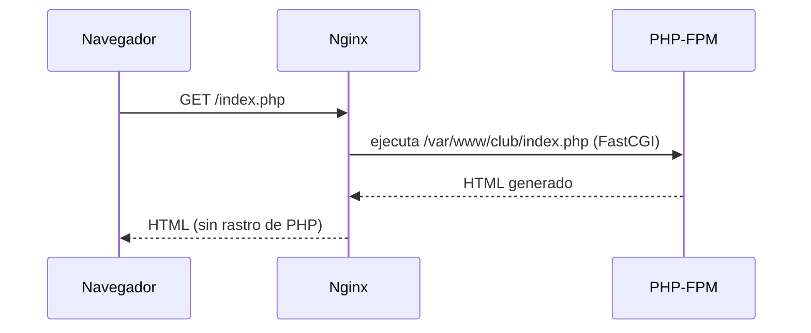

# UD4 · Entorno PHP: Nginx + PHP-FPM

<div class="presentacion" markdown>
:material-presentation-play:{ .presentacion__icono } **Presentación de clase** · 28 diapositivas (sesión 1: 1–19 · sesión 2: 20–28)

[:material-file-pdf-box: Descargar la presentación (PDF)](../assets/presentaciones/IAW-UD4.pdf){ .md-button .md-button--primary target="_blank" }
</div>

!!! info "Ficha de la unidad"
    * **Carga lectiva:** 4 horas presenciales (2 sesiones).
    * **Resultado de aprendizaje:** RA5, criterios a, b, c, d y e (la UD5, con Python, completa el RA5).
    * **Tecnologías:** [PHP-FPM](https://jmfiorisies.github.io/tech/php-fpm/) · [Nginx](https://jmfiorisies.github.io/tech/nginx/) · [Docker](https://jmfiorisies.github.io/tech/docker/)
    * **Referencias:** manual de PHP (php.net: configuración de FPM, directivas de `php.ini`), documentación de Nginx
      (`ngx_http_fastcgi_module`), OWASP *Cross Site Scripting Prevention Cheat Sheet*.

!!! tip "Cómo está organizada esta unidad"
    En la UD3, Nginx aprendió a servir ficheros y a reenviar peticiones a otro servidor. Ahora le pedimos algo
    nuevo: que una página **se genere en el momento**, con PHP. El orden importa:

    1. **Bloques 0 y 1:** qué es un lenguaje de servidor y cómo se ejecuta PHP, sin un solo comando.
    2. **Bloque 2:** las cinco líneas que conectan Nginx con PHP-FPM.
    3. **Bloque 3:** el laboratorio, paso a paso.
    4. **Bloques 4 y 5:** lo que un administrador tiene que saber leer de PHP, y cómo se cuela un XSS.
    5. **Bloques 6 a 9:** PHP en producción: `php.ini` endurecido, errores, el pool y el rendimiento.
    6. **Bloques 10 a 12:** diagnóstico, casos prácticos y glosario.

    Nuestro papel en ASIR **no es programar la aplicación**, sino instalarla, configurarla, asegurarla y saber
    arreglarla. Para eso hay que leer PHP con soltura, y eso es lo que practicamos aquí.

---

## 📖 0. Fundamentos: de páginas fijas a páginas que se generan

### 0.1 El problema

El Club de Lectura del instituto tiene una web en HTML. Funciona, pero:

- cada vez que cambian las lecturas, alguien tiene que **editar el HTML a mano**;
- no puede **recoger recomendaciones**: un formulario necesita algo que reciba los datos y haga algo con ellos;
- todos los visitantes ven **exactamente lo mismo**.

Con lo que sabemos hasta ahora, Nginx solo puede **entregar ficheros que ya existen** (o reenviar la petición a
otro servidor). Hace falta un **programa** que escriba la página en cada petición.

| | Web estática | Web dinámica |
|---|---|---|
| Qué hace el servidor | **Entrega** un fichero que ya existe | **Ejecuta** un programa y entrega lo que escribe |
| Cambiar el contenido | Editar el fichero | Cambiar los datos (después, en una base de datos) |
| Formularios | No puede procesarlos | Sí |
| Ejemplos | Esta web de apuntes (MkDocs) | WordPress, Moodle, Nextcloud |

### 0.2 Lenguaje de servidor: el navegador nunca ve el código

PHP es un **lenguaje de servidor**: el código se ejecuta en el servidor, y al navegador solo le llega el resultado.



Lo que hay en el disco del servidor:

```php
<p>Generada a las <?= date('H:i:s') ?></p>
<?php foreach ($libros as $l): ?>
  <li><?= $l['titulo'] ?></li>
<?php endforeach; ?>
```

Lo que recibe el navegador:

```html
<p>Generada a las 17:52:08</p>
  <li>El camino</li>
  <li>Nada</li>
```

!!! warning "JavaScript (DWEC) frente a PHP"
    JavaScript viaja al navegador y se ejecuta allí: cualquiera puede leerlo. PHP se queda en el servidor: el
    usuario nunca ve el código… **salvo que el servidor esté mal configurado** y le entregue el `.php` en vez de
    ejecutarlo. Entonces se descarga el código entero, con las contraseñas de la base de datos incluidas. Lo
    provocarás a propósito en el laboratorio (bloque 3).

---

## ⚙️ 1. Cómo se ejecuta PHP: CGI, mod_php y PHP-FPM

A lo largo de los años ha habido tres formas de que un servidor web ejecute PHP:

| | CGI | mod_php (Apache) | **PHP-FPM** |
|---|---|---|---|
| Cómo | Un proceso nuevo en **cada** petición | PHP **dentro** de cada proceso de Apache | Un servicio aparte con un **grupo (pool) de procesos** |
| Rapidez | Lento: arranca el intérprete cada vez | Rápido | Rápido: los procesos ya están arrancados |
| Memoria | Poca, pero mucho trabajo de arranque | Mucha: cada Apache carga PHP aunque sirva un `.css` | Solo los procesos de PHP cargan PHP |
| Servidor web | Cualquiera | Solo Apache, con el MPM prefork (UD2) | Nginx, Apache (`proxy_fcgi`), Caddy… |
| Hoy | Obsoleto | Heredado | **Lo estándar** |

Con **Nginx no existe mod_php**: Nginx no carga intérpretes dentro, porque su modelo es de eventos (el «camarero
ágil» de la UD3). Para ejecutar código, se lo pasa a otro proceso. Ese otro proceso es **PHP-FPM** (*FastCGI
Process Manager*), y el idioma en el que se hablan es **FastCGI**.

<!-- mapa:iaw-ud4-peticion -->

📖 Por dónde pasa una petición a un `.php` y qué hace cada pieza. Los números son los pasos; las letras se explican debajo del dibujo, junto con lo que ves cuando algo falla. **En la web, púlsalo para verlo en grande.**

<div class="mapa-iaw">
<div class="uml-barra"><span>UD4 · Nginx → FastCGI → PHP-FPM</span><button class="uml-btn" data-uml-abrir>🔍 Ampliar</button></div>
<div class="uml-lienzo" title="Pulsa para ampliar">
<svg xmlns="http://www.w3.org/2000/svg" width="1600" height="1103.25" viewBox="0 0 1600 1103.25">
<defs><filter id="iaw-ud4-peticion-sombra" x="-5%" y="-5%" width="110%" height="115%"><feDropShadow dx="0" dy="2" stdDeviation="3" flood-color="#000" flood-opacity=".12"/></filter><marker id="iaw-ud4-peticion-mf9334e6" viewBox="0 0 20 20" refX="16" refY="10" markerWidth="15" markerHeight="15" markerUnits="userSpaceOnUse" orient="auto-start-reverse"><path d="M2,2 L18,10 L2,18 z" fill="#9334e6"/></marker><marker id="iaw-ud4-peticion-mf5f6368" viewBox="0 0 20 20" refX="16" refY="10" markerWidth="15" markerHeight="15" markerUnits="userSpaceOnUse" orient="auto-start-reverse"><path d="M2,2 L18,10 L2,18 z" fill="#5f6368"/></marker><marker id="iaw-ud4-peticion-mf188038" viewBox="0 0 20 20" refX="16" refY="10" markerWidth="15" markerHeight="15" markerUnits="userSpaceOnUse" orient="auto-start-reverse"><path d="M2,2 L18,10 L2,18 z" fill="#188038"/></marker></defs>
<rect width="100%" height="100%" style="fill:var(--m-lienzo,#fff)"/>
<text x="40.0" y="44.0" text-anchor="start" font-family="'Inter', 'Segoe UI', 'DejaVu Sans', Helvetica, Arial, sans-serif" font-size="23" xml:space="preserve"><tspan font-weight="800" style="fill:var(--mt-202124,#202124)">UD4 · El viaje de una petición a PHP </tspan><tspan font-weight="400" style="fill:var(--mt-80868b,#80868b)">(Nginx delante, PHP-FPM detrás)</tspan></text>
<text x="40.0" y="72.0" text-anchor="start" font-family="'Inter', 'Segoe UI', 'DejaVu Sans', Helvetica, Arial, sans-serif" font-size="14" font-weight="400" xml:space="preserve" style="fill:var(--mt-5f6368,#5f6368)">Nginx no sabe PHP. Lo que acaba en .php se lo pasa a PHP-FPM por FastCGI; todo lo demás lo sirve él del disco.</text>
<g filter="url(#iaw-ud4-peticion-sombra)"><rect x="40" y="120" width="270" height="200" rx="10" stroke="#5f6368" stroke-width="2" style="fill:var(--mf-f6f7f8,#f6f7f8)"/><path d="M40,172 v-42 a10,10 0 0 1 10,-10 h250 a10,10 0 0 1 10,10 v42 z" fill="#5f6368" stroke="#5f6368" stroke-width="2"/></g>
<g transform="translate(54,135.0) scale(0.9166666666666666)" fill="none" stroke="#fff" stroke-width="2" stroke-linejoin="round"><rect x="2" y="3" width="20" height="13" rx="2"/><path d="M8,21 h8 M12,16 v5"/></g>
<text x="86.0" y="144.0" text-anchor="start" font-family="'Inter', 'Segoe UI', 'DejaVu Sans', Helvetica, Arial, sans-serif" font-size="17" font-weight="700" fill="#fff" xml:space="preserve">navegador</text>
<text x="86.0" y="159.0" text-anchor="start" font-family="'Inter', 'Segoe UI', 'DejaVu Sans', Helvetica, Arial, sans-serif" font-size="11.5" font-weight="400" fill="#fff" xml:space="preserve">el cliente</text>
<text x="56.0" y="205.0" text-anchor="start" font-family="'Inter', 'Segoe UI', 'DejaVu Sans', Helvetica, Arial, sans-serif" font-size="12.5" xml:space="preserve"><tspan font-weight="400" style="fill:var(--mt-5f6368,#5f6368)">Pide </tspan><tspan font-weight="600" font-family="'DejaVu Sans Mono', 'JetBrains Mono', Consolas, monospace" style="fill:var(--mt-202124,#202124)">/index.php</tspan><tspan font-weight="400" style="fill:var(--mt-5f6368,#5f6368)"> o</tspan></text>
<text x="56.0" y="223.8" text-anchor="start" font-family="'Inter', 'Segoe UI', 'DejaVu Sans', Helvetica, Arial, sans-serif" font-size="12.5" xml:space="preserve"><tspan font-weight="600" font-family="'DejaVu Sans Mono', 'JetBrains Mono', Consolas, monospace" style="fill:var(--mt-202124,#202124)">/estilo.css</tspan><tspan font-weight="400" style="fill:var(--mt-5f6368,#5f6368)">.</tspan></text>
<text x="56.0" y="255.0" text-anchor="start" font-family="'Inter', 'Segoe UI', 'DejaVu Sans', Helvetica, Arial, sans-serif" font-size="12.5" font-weight="400" xml:space="preserve" style="fill:var(--mt-5f6368,#5f6368)">Recibe solo HTML: nunca ve el</text>
<text x="56.0" y="273.8" text-anchor="start" font-family="'Inter', 'Segoe UI', 'DejaVu Sans', Helvetica, Arial, sans-serif" font-size="12.5" font-weight="400" xml:space="preserve" style="fill:var(--mt-5f6368,#5f6368)">código PHP. Con «Ver código</text>
<text x="56.0" y="292.5" text-anchor="start" font-family="'Inter', 'Segoe UI', 'DejaVu Sans', Helvetica, Arial, sans-serif" font-size="12.5" font-weight="400" xml:space="preserve" style="fill:var(--mt-5f6368,#5f6368)">fuente» solo sale el resultado.</text>
<g filter="url(#iaw-ud4-peticion-sombra)"><rect x="420" y="120" width="560" height="420" rx="10" stroke="#188038" stroke-width="2" style="fill:var(--mf-e6f4ea,#e6f4ea)"/><path d="M420,172 v-42 a10,10 0 0 1 10,-10 h540 a10,10 0 0 1 10,10 v42 z" fill="#188038" stroke="#188038" stroke-width="2"/></g>
<g transform="translate(434,135.0) scale(0.9166666666666666)" fill="none" stroke="#fff" stroke-width="2" stroke-linejoin="round"><rect x="3" y="2" width="18" height="8" rx="2"/><rect x="3" y="13" width="18" height="8" rx="2"/><circle cx="7" cy="6" r="1" fill="#fff"/><circle cx="7" cy="17" r="1" fill="#fff"/></g>
<text x="466.0" y="144.0" text-anchor="start" font-family="'Inter', 'Segoe UI', 'DejaVu Sans', Helvetica, Arial, sans-serif" font-size="17" font-weight="700" fill="#fff" xml:space="preserve">nginx</text>
<text x="466.0" y="159.0" text-anchor="start" font-family="'Inter', 'Segoe UI', 'DejaVu Sans', Helvetica, Arial, sans-serif" font-size="11.5" font-weight="400" fill="#fff" xml:space="preserve">el camarero: TLS, estáticos y reparto</text>
<text x="440.0" y="202.0" text-anchor="start" font-family="'Inter', 'Segoe UI', 'DejaVu Sans', Helvetica, Arial, sans-serif" font-size="13" font-weight="700" xml:space="preserve" style="fill:var(--mt-202124,#202124)">Mira cómo acaba lo que le piden:</text>
<rect x="440.0" y="218.0" width="520.0" height="82.0" rx="9" stroke="#188038" stroke-width="1.6" style="fill:var(--m-fondo,#fff)"/>
<text x="454.0" y="242.0" text-anchor="start" font-family="'Inter', 'Segoe UI', 'DejaVu Sans', Helvetica, Arial, sans-serif" font-size="13.5" font-weight="700" xml:space="preserve" style="fill:var(--mt-188038,#188038)">Un fichero estático (.css, .jpg, .txt)</text>
<text x="454.0" y="264.0" text-anchor="start" font-family="'Inter', 'Segoe UI', 'DejaVu Sans', Helvetica, Arial, sans-serif" font-size="12.5" font-weight="400" xml:space="preserve" style="fill:var(--mt-5f6368,#5f6368)">Lo lee de /var/www/club y lo devuelve él. No gasta PHP.</text>
<rect x="440.0" y="316.0" width="520.0" height="184.0" rx="8" stroke-width="1.2" style="fill:var(--mf-f8f9fa,#f8f9fa);stroke:var(--mf-dadce0,#dadce0)"/>
<text x="454.0" y="338.0" text-anchor="start" font-family="'Inter', 'Segoe UI', 'DejaVu Sans', Helvetica, Arial, sans-serif" font-size="11.5" font-weight="700" xml:space="preserve" style="fill:var(--mt-188038,#188038)">Un .php → esta regla (nginx/sites-available/club.conf)</text>
<text x="454.0" y="362.0" text-anchor="start" font-family="'DejaVu Sans Mono', 'JetBrains Mono', Consolas, monospace" font-size="12.5" font-weight="400" xml:space="preserve" style="fill:var(--mt-202124,#202124)">location ~ \.php$ {</text>
<circle cx="942" cy="358" r="10" fill="#188038"/>
<text x="942.0" y="362.5" text-anchor="middle" font-family="'Inter', 'Segoe UI', 'DejaVu Sans', Helvetica, Arial, sans-serif" font-size="13" font-weight="800" fill="#fff" xml:space="preserve">A</text>
<text x="454.0" y="382.0" text-anchor="start" font-family="'DejaVu Sans Mono', 'JetBrains Mono', Consolas, monospace" font-size="12.5" font-weight="400" xml:space="preserve" style="fill:var(--mt-202124,#202124)">    try_files $uri =404;</text>
<text x="454.0" y="402.0" text-anchor="start" font-family="'DejaVu Sans Mono', 'JetBrains Mono', Consolas, monospace" font-size="12.5" font-weight="400" xml:space="preserve" style="fill:var(--mt-202124,#202124)">    fastcgi_pass  php:9000;</text>
<circle cx="942" cy="398" r="10" fill="#188038"/>
<text x="942.0" y="402.5" text-anchor="middle" font-family="'Inter', 'Segoe UI', 'DejaVu Sans', Helvetica, Arial, sans-serif" font-size="13" font-weight="800" fill="#fff" xml:space="preserve">B</text>
<text x="454.0" y="422.0" text-anchor="start" font-family="'DejaVu Sans Mono', 'JetBrains Mono', Consolas, monospace" font-size="12.5" font-weight="400" xml:space="preserve" style="fill:var(--mt-202124,#202124)">    include       fastcgi_params;</text>
<text x="454.0" y="442.0" text-anchor="start" font-family="'DejaVu Sans Mono', 'JetBrains Mono', Consolas, monospace" font-size="12.5" font-weight="400" xml:space="preserve" style="fill:var(--mt-202124,#202124)">    fastcgi_param SCRIPT_FILENAME</text>
<circle cx="942" cy="438" r="10" fill="#188038"/>
<text x="942.0" y="442.5" text-anchor="middle" font-family="'Inter', 'Segoe UI', 'DejaVu Sans', Helvetica, Arial, sans-serif" font-size="13" font-weight="800" fill="#fff" xml:space="preserve">C</text>
<text x="454.0" y="462.0" text-anchor="start" font-family="'DejaVu Sans Mono', 'JetBrains Mono', Consolas, monospace" font-size="12.5" font-weight="400" xml:space="preserve" style="fill:var(--mt-202124,#202124)">        $document_root$fastcgi_script_name;</text>
<text x="454.0" y="482.0" text-anchor="start" font-family="'DejaVu Sans Mono', 'JetBrains Mono', Consolas, monospace" font-size="12.5" font-weight="400" xml:space="preserve" style="fill:var(--mt-202124,#202124)">}</text>
<text x="700.0" y="526.0" text-anchor="middle" font-family="'Inter', 'Segoe UI', 'DejaVu Sans', Helvetica, Arial, sans-serif" font-size="12" font-weight="400" xml:space="preserve" font-style="italic" style="fill:var(--mt-5f6368,#5f6368)">las cinco líneas del apartado 2.1</text>
<g filter="url(#iaw-ud4-peticion-sombra)"><rect x="1100" y="120" width="460" height="420" rx="10" stroke="#9334e6" stroke-width="2" style="fill:var(--mf-f6efff,#f6efff)"/><path d="M1100,172 v-42 a10,10 0 0 1 10,-10 h440 a10,10 0 0 1 10,10 v42 z" fill="#9334e6" stroke="#9334e6" stroke-width="2"/></g>
<g transform="translate(1114,135.0) scale(0.9166666666666666)" fill="none" stroke="#fff" stroke-width="2" stroke-linejoin="round"><circle cx="12" cy="12" r="3.5"/><path d="M12,2 v3 M12,19 v3 M2,12 h3 M19,12 h3 M4.9,4.9 l2.1,2.1 M17,17 l2.1,2.1 M4.9,19.1 l2.1,-2.1 M17,7 l2.1,-2.1"/><circle cx="12" cy="12" r="7"/></g>
<text x="1146.0" y="144.0" text-anchor="start" font-family="'Inter', 'Segoe UI', 'DejaVu Sans', Helvetica, Arial, sans-serif" font-size="17" font-weight="700" fill="#fff" xml:space="preserve">php · PHP-FPM 8.3</text>
<text x="1146.0" y="159.0" text-anchor="start" font-family="'Inter', 'Segoe UI', 'DejaVu Sans', Helvetica, Arial, sans-serif" font-size="11.5" font-weight="400" fill="#fff" xml:space="preserve">otro servicio: escucha en el puerto 9000</text>
<rect x="1120.0" y="190.0" width="420.0" height="84.0" rx="9" stroke="#9334e6" stroke-width="1.6" style="fill:var(--m-fondo,#fff)"/>
<text x="1134.0" y="214.0" text-anchor="start" font-family="'Inter', 'Segoe UI', 'DejaVu Sans', Helvetica, Arial, sans-serif" font-size="13.5" font-weight="700" xml:space="preserve" style="fill:var(--mt-9334e6,#9334e6)">proceso maestro (root)</text>
<text x="1134.0" y="236.0" text-anchor="start" font-family="'Inter', 'Segoe UI', 'DejaVu Sans', Helvetica, Arial, sans-serif" font-size="12.5" font-weight="400" xml:space="preserve" style="fill:var(--mt-5f6368,#5f6368)">Lee la configuración y reparte: no ejecuta PHP.</text>
<rect x="1120.0" y="320.0" width="132.0" height="92.0" rx="9" stroke="#9334e6" stroke-width="1.6" style="fill:var(--m-fondo,#fff)"/>
<g transform="translate(1130,330) scale(0.8333333333333334)" fill="none" stroke="#9334e6" stroke-width="2" stroke-linejoin="round"><circle cx="12" cy="12" r="3.5"/><path d="M12,2 v3 M12,19 v3 M2,12 h3 M19,12 h3 M4.9,4.9 l2.1,2.1 M17,17 l2.1,2.1 M4.9,19.1 l2.1,-2.1 M17,7 l2.1,-2.1"/><circle cx="12" cy="12" r="7"/></g>
<text x="1158.0" y="346.0" text-anchor="start" font-family="'Inter', 'Segoe UI', 'DejaVu Sans', Helvetica, Arial, sans-serif" font-size="13" font-weight="700" xml:space="preserve" style="fill:var(--mt-9334e6,#9334e6)">worker 1</text>
<text x="1132.0" y="372.0" text-anchor="start" font-family="'DejaVu Sans Mono', 'JetBrains Mono', Consolas, monospace" font-size="12" font-weight="600" xml:space="preserve" style="fill:var(--mt-5f6368,#5f6368)">www-data</text>
<text x="1132.0" y="394.0" text-anchor="start" font-family="'Inter', 'Segoe UI', 'DejaVu Sans', Helvetica, Arial, sans-serif" font-size="11.5" font-weight="400" xml:space="preserve" style="fill:var(--mt-5f6368,#5f6368)">1 petición a la vez</text>
<path d="M1330,274 L1186,318" fill="none" stroke="#9334e6" stroke-width="1.6" stroke-linecap="round" stroke-linejoin="round" marker-end="url(#iaw-ud4-peticion-mf9334e6)"/>
<rect x="1262.0" y="320.0" width="132.0" height="92.0" rx="9" stroke="#9334e6" stroke-width="1.6" style="fill:var(--m-fondo,#fff)"/>
<g transform="translate(1272,330) scale(0.8333333333333334)" fill="none" stroke="#9334e6" stroke-width="2" stroke-linejoin="round"><circle cx="12" cy="12" r="3.5"/><path d="M12,2 v3 M12,19 v3 M2,12 h3 M19,12 h3 M4.9,4.9 l2.1,2.1 M17,17 l2.1,2.1 M4.9,19.1 l2.1,-2.1 M17,7 l2.1,-2.1"/><circle cx="12" cy="12" r="7"/></g>
<text x="1300.0" y="346.0" text-anchor="start" font-family="'Inter', 'Segoe UI', 'DejaVu Sans', Helvetica, Arial, sans-serif" font-size="13" font-weight="700" xml:space="preserve" style="fill:var(--mt-9334e6,#9334e6)">worker 2</text>
<text x="1274.0" y="372.0" text-anchor="start" font-family="'DejaVu Sans Mono', 'JetBrains Mono', Consolas, monospace" font-size="12" font-weight="600" xml:space="preserve" style="fill:var(--mt-5f6368,#5f6368)">www-data</text>
<text x="1274.0" y="394.0" text-anchor="start" font-family="'Inter', 'Segoe UI', 'DejaVu Sans', Helvetica, Arial, sans-serif" font-size="11.5" font-weight="400" xml:space="preserve" style="fill:var(--mt-5f6368,#5f6368)">1 petición a la vez</text>
<path d="M1330,274 L1328,318" fill="none" stroke="#9334e6" stroke-width="1.6" stroke-linecap="round" stroke-linejoin="round" marker-end="url(#iaw-ud4-peticion-mf9334e6)"/>
<rect x="1404.0" y="320.0" width="132.0" height="92.0" rx="9" stroke="#9334e6" stroke-width="1.6" style="fill:var(--m-fondo,#fff)"/>
<g transform="translate(1414,330) scale(0.8333333333333334)" fill="none" stroke="#9334e6" stroke-width="2" stroke-linejoin="round"><circle cx="12" cy="12" r="3.5"/><path d="M12,2 v3 M12,19 v3 M2,12 h3 M19,12 h3 M4.9,4.9 l2.1,2.1 M17,17 l2.1,2.1 M4.9,19.1 l2.1,-2.1 M17,7 l2.1,-2.1"/><circle cx="12" cy="12" r="7"/></g>
<text x="1442.0" y="346.0" text-anchor="start" font-family="'Inter', 'Segoe UI', 'DejaVu Sans', Helvetica, Arial, sans-serif" font-size="13" font-weight="700" xml:space="preserve" style="fill:var(--mt-9334e6,#9334e6)">worker N</text>
<text x="1416.0" y="372.0" text-anchor="start" font-family="'DejaVu Sans Mono', 'JetBrains Mono', Consolas, monospace" font-size="12" font-weight="600" xml:space="preserve" style="fill:var(--mt-5f6368,#5f6368)">www-data</text>
<text x="1416.0" y="394.0" text-anchor="start" font-family="'Inter', 'Segoe UI', 'DejaVu Sans', Helvetica, Arial, sans-serif" font-size="11.5" font-weight="400" xml:space="preserve" style="fill:var(--mt-5f6368,#5f6368)">1 petición a la vez</text>
<path d="M1330,274 L1470,318" fill="none" stroke="#9334e6" stroke-width="1.6" stroke-linecap="round" stroke-linejoin="round" marker-end="url(#iaw-ud4-peticion-mf9334e6)"/>
<rect x="1120.0" y="424.0" width="420.0" height="66.0" rx="8" stroke="#9334e6" stroke-width="1.2" stroke-dasharray="5 4" style="fill:var(--m-fondo,#fff)"/>
<circle cx="1140" cy="448" r="11" fill="#9334e6"/>
<text x="1140.0" y="452.5" text-anchor="middle" font-family="'Inter', 'Segoe UI', 'DejaVu Sans', Helvetica, Arial, sans-serif" font-size="13" font-weight="800" fill="#fff" xml:space="preserve">D</text>
<text x="1160.0" y="453.0" text-anchor="start" font-family="'Inter', 'Segoe UI', 'DejaVu Sans', Helvetica, Arial, sans-serif" font-size="13" xml:space="preserve"><tspan font-weight="700" style="fill:var(--mt-202124,#202124)">Como mucho </tspan><tspan font-weight="600" font-family="'DejaVu Sans Mono', 'JetBrains Mono', Consolas, monospace" style="fill:var(--mt-9334e6,#9334e6)">pm.max_children</tspan><tspan font-weight="700" style="fill:var(--mt-202124,#202124)"> workers</tspan></text>
<text x="1160.0" y="475.0" text-anchor="start" font-family="'Inter', 'Segoe UI', 'DejaVu Sans', Helvetica, Arial, sans-serif" font-size="12.5" font-weight="400" xml:space="preserve" style="fill:var(--mt-5f6368,#5f6368)">a la vez. Los demás esperan en cola.</text>
<text x="1330.0" y="510.0" text-anchor="middle" font-family="'DejaVu Sans Mono', 'JetBrains Mono', Consolas, monospace" font-size="12.5" font-weight="700" xml:space="preserve" style="fill:var(--mt-9334e6,#9334e6)">mem_limit: 512 MB</text>
<text x="1330.0" y="530.0" text-anchor="middle" font-family="'Inter', 'Segoe UI', 'DejaVu Sans', Helvetica, Arial, sans-serif" font-size="12" font-weight="400" xml:space="preserve" style="fill:var(--mt-5f6368,#5f6368)">Solo está en la red interna: desde fuera no se llega.</text>
<path d="M310,196 H418" fill="none" stroke="#5f6368" stroke-width="2.4" stroke-linecap="round" stroke-linejoin="round" marker-end="url(#iaw-ud4-peticion-mf5f6368)"/>
<circle cx="311.0" cy="182" r="11" fill="#5f6368"/>
<text x="311.0" y="186.5" text-anchor="middle" font-family="'Inter', 'Segoe UI', 'DejaVu Sans', Helvetica, Arial, sans-serif" font-size="13" font-weight="800" fill="#fff" xml:space="preserve">1</text>
<text x="328.0" y="186.0" text-anchor="start" font-family="'Inter', 'Segoe UI', 'DejaVu Sans', Helvetica, Arial, sans-serif" font-size="12.5" font-weight="700" xml:space="preserve" paint-order="stroke" stroke-width="5" stroke-linejoin="round" style="fill:var(--mt-5f6368,#5f6368);stroke:var(--m-fondo,#fff)">GET /index.php</text>
<text x="364.0" y="214.0" text-anchor="middle" font-family="'DejaVu Sans Mono', 'JetBrains Mono', Consolas, monospace" font-size="12" font-weight="600" xml:space="preserve" style="fill:var(--mt-5f6368,#5f6368)">HTTPS :443</text>
<path d="M980,420 C1040,420 1040,240 1098,240" fill="none" stroke="#188038" stroke-width="2.4" stroke-linecap="round" stroke-linejoin="round" marker-end="url(#iaw-ud4-peticion-mf188038)"/>
<circle cx="1011.5" cy="282" r="11" fill="#188038"/>
<text x="1011.5" y="286.5" text-anchor="middle" font-family="'Inter', 'Segoe UI', 'DejaVu Sans', Helvetica, Arial, sans-serif" font-size="13" font-weight="800" fill="#fff" xml:space="preserve">2</text>
<text x="1028.5" y="286.0" text-anchor="start" font-family="'Inter', 'Segoe UI', 'DejaVu Sans', Helvetica, Arial, sans-serif" font-size="12.5" font-weight="700" xml:space="preserve" paint-order="stroke" stroke-width="5" stroke-linejoin="round" style="fill:var(--mt-188038,#188038);stroke:var(--m-fondo,#fff)">FastCGI</text>
<text x="1040.0" y="306.0" text-anchor="middle" font-family="'DejaVu Sans Mono', 'JetBrains Mono', Consolas, monospace" font-size="12" font-weight="600" xml:space="preserve" paint-order="stroke" stroke-width="5" stroke-linejoin="round" style="fill:var(--mt-5f6368,#5f6368);stroke:var(--m-fondo,#fff)">php:9000</text>
<path d="M1098,500 H982" fill="none" stroke="#9334e6" stroke-width="2.2" stroke-linecap="round" stroke-linejoin="round" stroke-dasharray="7 5" marker-end="url(#iaw-ud4-peticion-mf9334e6)"/>
<circle cx="1022.0" cy="482" r="11" fill="#9334e6"/>
<text x="1022.0" y="486.5" text-anchor="middle" font-family="'Inter', 'Segoe UI', 'DejaVu Sans', Helvetica, Arial, sans-serif" font-size="13" font-weight="800" fill="#fff" xml:space="preserve">4</text>
<text x="1039.0" y="486.0" text-anchor="start" font-family="'Inter', 'Segoe UI', 'DejaVu Sans', Helvetica, Arial, sans-serif" font-size="12.5" font-weight="700" xml:space="preserve" paint-order="stroke" stroke-width="5" stroke-linejoin="round" style="fill:var(--mt-9334e6,#9334e6);stroke:var(--m-fondo,#fff)">HTML</text>
<path d="M418,330 H312" fill="none" stroke="#188038" stroke-width="2.2" stroke-linecap="round" stroke-linejoin="round" stroke-dasharray="7 5" marker-end="url(#iaw-ud4-peticion-mf188038)"/>
<circle cx="328.5" cy="316" r="11" fill="#188038"/>
<text x="328.5" y="320.5" text-anchor="middle" font-family="'Inter', 'Segoe UI', 'DejaVu Sans', Helvetica, Arial, sans-serif" font-size="13" font-weight="800" fill="#fff" xml:space="preserve">5</text>
<text x="345.5" y="320.0" text-anchor="start" font-family="'Inter', 'Segoe UI', 'DejaVu Sans', Helvetica, Arial, sans-serif" font-size="12.5" font-weight="700" xml:space="preserve" paint-order="stroke" stroke-width="5" stroke-linejoin="round" style="fill:var(--mt-188038,#188038);stroke:var(--m-fondo,#fff)">solo HTML</text>
<text x="364.0" y="348.0" text-anchor="middle" font-family="'Inter', 'Segoe UI', 'DejaVu Sans', Helvetica, Arial, sans-serif" font-size="12" font-weight="400" xml:space="preserve" paint-order="stroke" stroke-width="5" stroke-linejoin="round" style="fill:var(--mt-5f6368,#5f6368);stroke:var(--m-fondo,#fff)">sin rastro de PHP</text>
<rect x="420.0" y="600.0" width="1140.0" height="120.0" rx="12" stroke="#e37400" stroke-width="1.8" style="fill:var(--mf-fef7e0,#fef7e0)"/>
<g transform="translate(438,616) scale(1.25)" fill="none" stroke="#e37400" stroke-width="2" stroke-linejoin="round"><ellipse cx="12" cy="5" rx="8" ry="3"/><path d="M4,5 V19 a8,3 0 0 0 16,0 V5"/><path d="M4,12 a8,3 0 0 0 16,0"/></g>
<text x="480.0" y="636.0" text-anchor="start" font-family="'Inter', 'Segoe UI', 'DejaVu Sans', Helvetica, Arial, sans-serif" font-size="15" xml:space="preserve"><tspan font-weight="600" font-family="'DejaVu Sans Mono', 'JetBrains Mono', Consolas, monospace" style="fill:var(--mt-e37400,#e37400)">/var/www/club</tspan><tspan font-weight="700" style="fill:var(--mt-202124,#202124)"> · la misma carpeta en los dos contenedores (en el kit, </tspan><tspan font-weight="600" font-family="'DejaVu Sans Mono', 'JetBrains Mono', Consolas, monospace" style="fill:var(--mt-e37400,#e37400)">www/club/</tspan><tspan font-weight="700" style="fill:var(--mt-202124,#202124)">)</tspan></text>
<rect x="480.0" y="669.0" width="84.6" height="22" rx="11.0" stroke="#e37400" stroke-width="1.3" style="fill:var(--m-fondo,#fff)"/>
<text x="522.3" y="684.5" text-anchor="middle" font-family="'DejaVu Sans Mono', 'JetBrains Mono', Consolas, monospace" font-size="12.5" font-weight="600" xml:space="preserve" style="fill:var(--mt-e37400,#e37400)">index.php</text>
<rect x="574.6" y="669.0" width="122.8" height="22" rx="11.0" stroke="#e37400" stroke-width="1.3" style="fill:var(--m-fondo,#fff)"/>
<text x="636.0" y="684.5" text-anchor="middle" font-family="'DejaVu Sans Mono', 'JetBrains Mono', Consolas, monospace" font-size="12.5" font-weight="600" xml:space="preserve" style="fill:var(--mt-e37400,#e37400)">recomendar.php</text>
<rect x="707.4" y="669.0" width="92.2" height="22" rx="11.0" stroke="#e37400" stroke-width="1.3" style="fill:var(--m-fondo,#fff)"/>
<text x="753.5" y="684.5" text-anchor="middle" font-family="'DejaVu Sans Mono', 'JetBrains Mono', Consolas, monospace" font-size="12.5" font-weight="600" xml:space="preserve" style="fill:var(--mt-e37400,#e37400)">estilo.css</text>
<rect x="809.6" y="669.0" width="77.0" height="22" rx="11.0" stroke="#e37400" stroke-width="1.3" style="fill:var(--m-fondo,#fff)"/>
<text x="848.1" y="684.5" text-anchor="middle" font-family="'DejaVu Sans Mono', 'JetBrains Mono', Consolas, monospace" font-size="12.5" font-weight="600" xml:space="preserve" style="fill:var(--mt-e37400,#e37400)">hola.txt</text>
<rect x="896.6" y="669.0" width="138.0" height="22" rx="11.0" stroke="#e37400" stroke-width="1.3" style="fill:var(--m-fondo,#fff)"/>
<text x="965.6" y="684.5" text-anchor="middle" font-family="'DejaVu Sans Mono', 'JetBrains Mono', Consolas, monospace" font-size="12.5" font-weight="600" xml:space="preserve" style="fill:var(--mt-e37400,#e37400)">inc/  (deny all)</text>
<path d="M700,542 V598" fill="none" stroke="#188038" stroke-width="2" stroke-linecap="round" stroke-linejoin="round" stroke-dasharray="5 4" marker-end="url(#iaw-ud4-peticion-mf188038)"/>
<text x="712.0" y="576.0" text-anchor="start" font-family="'Inter', 'Segoe UI', 'DejaVu Sans', Helvetica, Arial, sans-serif" font-size="12" font-weight="600" xml:space="preserve" paint-order="stroke" stroke-width="5" stroke-linejoin="round" style="fill:var(--mt-188038,#188038);stroke:var(--m-fondo,#fff)">estáticos: los lee nginx</text>
<path d="M1330,542 V598" fill="none" stroke="#9334e6" stroke-width="2.4" stroke-linecap="round" stroke-linejoin="round" marker-end="url(#iaw-ud4-peticion-mf9334e6)"/>
<circle cx="1047.0" cy="572" r="11" fill="#9334e6"/>
<text x="1047.0" y="576.5" text-anchor="middle" font-family="'Inter', 'Segoe UI', 'DejaVu Sans', Helvetica, Arial, sans-serif" font-size="13" font-weight="800" fill="#fff" xml:space="preserve">3</text>
<text x="1064.0" y="576.0" text-anchor="start" font-family="'Inter', 'Segoe UI', 'DejaVu Sans', Helvetica, Arial, sans-serif" font-size="12.5" font-weight="700" xml:space="preserve" paint-order="stroke" stroke-width="5" stroke-linejoin="round" style="fill:var(--mt-9334e6,#9334e6);stroke:var(--m-fondo,#fff)">un worker lee index.php y lo ejecuta</text>
<rect x="40.0" y="770.0" width="365.0" height="123.0" rx="10" stroke-width="1.2" filter="url(#iaw-ud4-peticion-sombra)" style="fill:var(--m-fondo,#fff);stroke:var(--mf-dadce0,#dadce0)"/>
<rect x="40.0" y="770" width="6" height="123.0" rx="3" fill="#188038"/>
<circle cx="68.0" cy="792" r="12" fill="#188038"/>
<text x="68.0" y="796.5" text-anchor="middle" font-family="'Inter', 'Segoe UI', 'DejaVu Sans', Helvetica, Arial, sans-serif" font-size="13" font-weight="800" fill="#fff" xml:space="preserve">A</text>
<text x="88.0" y="797.0" text-anchor="start" font-family="'Inter', 'Segoe UI', 'DejaVu Sans', Helvetica, Arial, sans-serif" font-size="14" xml:space="preserve"><tspan font-weight="600" font-family="'DejaVu Sans Mono', 'JetBrains Mono', Consolas, monospace" style="fill:var(--mt-188038,#188038)">location ~ \.php$</tspan></text>
<text x="62.0" y="822.0" text-anchor="start" font-family="'Inter', 'Segoe UI', 'DejaVu Sans', Helvetica, Arial, sans-serif" font-size="12.5" font-weight="400" xml:space="preserve" style="fill:var(--mt-5f6368,#5f6368)">Solo lo que acaba en .php va a PHP. Sin esta</text>
<text x="62.0" y="840.8" text-anchor="start" font-family="'Inter', 'Segoe UI', 'DejaVu Sans', Helvetica, Arial, sans-serif" font-size="12.5" font-weight="400" xml:space="preserve" style="fill:var(--mt-5f6368,#5f6368)">regla, Nginx trata el .php como un fichero</text>
<text x="62.0" y="859.5" text-anchor="start" font-family="'Inter', 'Segoe UI', 'DejaVu Sans', Helvetica, Arial, sans-serif" font-size="12.5" font-weight="400" xml:space="preserve" style="fill:var(--mt-5f6368,#5f6368)">más y lo descarga con el código dentro.</text>
<rect x="425.0" y="770.0" width="365.0" height="123.0" rx="10" stroke-width="1.2" filter="url(#iaw-ud4-peticion-sombra)" style="fill:var(--m-fondo,#fff);stroke:var(--mf-dadce0,#dadce0)"/>
<rect x="425.0" y="770" width="6" height="123.0" rx="3" fill="#188038"/>
<circle cx="453.0" cy="792" r="12" fill="#188038"/>
<text x="453.0" y="796.5" text-anchor="middle" font-family="'Inter', 'Segoe UI', 'DejaVu Sans', Helvetica, Arial, sans-serif" font-size="13" font-weight="800" fill="#fff" xml:space="preserve">B</text>
<text x="473.0" y="797.0" text-anchor="start" font-family="'Inter', 'Segoe UI', 'DejaVu Sans', Helvetica, Arial, sans-serif" font-size="14" xml:space="preserve"><tspan font-weight="600" font-family="'DejaVu Sans Mono', 'JetBrains Mono', Consolas, monospace" style="fill:var(--mt-188038,#188038)">fastcgi_pass php:9000</tspan></text>
<text x="447.0" y="822.0" text-anchor="start" font-family="'Inter', 'Segoe UI', 'DejaVu Sans', Helvetica, Arial, sans-serif" font-size="12.5" xml:space="preserve"><tspan font-weight="400" style="fill:var(--mt-5f6368,#5f6368)">A quién se lo pasa: al contenedor </tspan><tspan font-weight="600" font-family="'DejaVu Sans Mono', 'JetBrains Mono', Consolas, monospace" style="fill:var(--mt-202124,#202124)">php</tspan><tspan font-weight="400" style="fill:var(--mt-5f6368,#5f6368)">,</tspan></text>
<text x="447.0" y="840.8" text-anchor="start" font-family="'Inter', 'Segoe UI', 'DejaVu Sans', Helvetica, Arial, sans-serif" font-size="12.5" font-weight="400" xml:space="preserve" style="fill:var(--mt-5f6368,#5f6368)">puerto 9000 (TCP). En un Debian sin Docker,</text>
<text x="447.0" y="859.5" text-anchor="start" font-family="'Inter', 'Segoe UI', 'DejaVu Sans', Helvetica, Arial, sans-serif" font-size="12.5" xml:space="preserve"><tspan font-weight="400" style="fill:var(--mt-5f6368,#5f6368)">al socket </tspan><tspan font-weight="600" font-family="'DejaVu Sans Mono', 'JetBrains Mono', Consolas, monospace" style="fill:var(--mt-202124,#202124)">unix:/run/php/php8.3-fpm.sock</tspan><tspan font-weight="400" style="fill:var(--mt-5f6368,#5f6368)">.</tspan></text>
<rect x="810.0" y="770.0" width="365.0" height="123.0" rx="10" stroke-width="1.2" filter="url(#iaw-ud4-peticion-sombra)" style="fill:var(--m-fondo,#fff);stroke:var(--mf-dadce0,#dadce0)"/>
<rect x="810.0" y="770" width="6" height="123.0" rx="3" fill="#188038"/>
<circle cx="838.0" cy="792" r="12" fill="#188038"/>
<text x="838.0" y="796.5" text-anchor="middle" font-family="'Inter', 'Segoe UI', 'DejaVu Sans', Helvetica, Arial, sans-serif" font-size="13" font-weight="800" fill="#fff" xml:space="preserve">C</text>
<text x="858.0" y="797.0" text-anchor="start" font-family="'Inter', 'Segoe UI', 'DejaVu Sans', Helvetica, Arial, sans-serif" font-size="14" xml:space="preserve"><tspan font-weight="600" font-family="'DejaVu Sans Mono', 'JetBrains Mono', Consolas, monospace" style="fill:var(--mt-188038,#188038)">SCRIPT_FILENAME</tspan></text>
<text x="832.0" y="822.0" text-anchor="start" font-family="'Inter', 'Segoe UI', 'DejaVu Sans', Helvetica, Arial, sans-serif" font-size="12.5" font-weight="400" xml:space="preserve" style="fill:var(--mt-5f6368,#5f6368)">Le dice a PHP qué fichero ejecutar:</text>
<text x="832.0" y="840.8" text-anchor="start" font-family="'Inter', 'Segoe UI', 'DejaVu Sans', Helvetica, Arial, sans-serif" font-size="12.5" xml:space="preserve"><tspan font-weight="600" font-family="'DejaVu Sans Mono', 'JetBrains Mono', Consolas, monospace" style="fill:var(--mt-202124,#202124)">$document_root</tspan><tspan font-weight="400" style="fill:var(--mt-5f6368,#5f6368)"> + la ruta pedida =</tspan></text>
<text x="832.0" y="859.5" text-anchor="start" font-family="'Inter', 'Segoe UI', 'DejaVu Sans', Helvetica, Arial, sans-serif" font-size="12.5" xml:space="preserve"><tspan font-weight="600" font-family="'DejaVu Sans Mono', 'JetBrains Mono', Consolas, monospace" style="fill:var(--mt-202124,#202124)">/var/www/club/index.php</tspan><tspan font-weight="400" style="fill:var(--mt-5f6368,#5f6368)">. Por eso la carpeta</tspan></text>
<text x="832.0" y="878.2" text-anchor="start" font-family="'Inter', 'Segoe UI', 'DejaVu Sans', Helvetica, Arial, sans-serif" font-size="12.5" font-weight="400" xml:space="preserve" style="fill:var(--mt-5f6368,#5f6368)">tiene que estar en la misma ruta en los dos.</text>
<rect x="1195.0" y="770.0" width="365.0" height="123.0" rx="10" stroke-width="1.2" filter="url(#iaw-ud4-peticion-sombra)" style="fill:var(--m-fondo,#fff);stroke:var(--mf-dadce0,#dadce0)"/>
<rect x="1195.0" y="770" width="6" height="123.0" rx="3" fill="#9334e6"/>
<circle cx="1223.0" cy="792" r="12" fill="#9334e6"/>
<text x="1223.0" y="796.5" text-anchor="middle" font-family="'Inter', 'Segoe UI', 'DejaVu Sans', Helvetica, Arial, sans-serif" font-size="13" font-weight="800" fill="#fff" xml:space="preserve">D</text>
<text x="1243.0" y="797.0" text-anchor="start" font-family="'Inter', 'Segoe UI', 'DejaVu Sans', Helvetica, Arial, sans-serif" font-size="14" xml:space="preserve"><tspan font-weight="600" font-family="'DejaVu Sans Mono', 'JetBrains Mono', Consolas, monospace" style="fill:var(--mt-9334e6,#9334e6)">pm.max_children</tspan></text>
<text x="1217.0" y="822.0" text-anchor="start" font-family="'Inter', 'Segoe UI', 'DejaVu Sans', Helvetica, Arial, sans-serif" font-size="12.5" font-weight="400" xml:space="preserve" style="fill:var(--mt-5f6368,#5f6368)">Peticiones PHP a la vez. Se calcula con la</text>
<text x="1217.0" y="840.8" text-anchor="start" font-family="'Inter', 'Segoe UI', 'DejaVu Sans', Helvetica, Arial, sans-serif" font-size="12.5" font-weight="400" xml:space="preserve" style="fill:var(--mt-5f6368,#5f6368)">memoria: (512 − 112) ÷ 40 MB por worker = 10</text>
<text x="1217.0" y="859.5" text-anchor="start" font-family="'Inter', 'Segoe UI', 'DejaVu Sans', Helvetica, Arial, sans-serif" font-size="12.5" font-weight="400" xml:space="preserve" style="fill:var(--mt-5f6368,#5f6368)">(apartado 8.2). Si se llena, todo va lento.</text>
<text x="1560.0" y="758.0" text-anchor="end" font-family="'Inter', 'Segoe UI', 'DejaVu Sans', Helvetica, Arial, sans-serif" font-size="12" font-weight="400" xml:space="preserve" font-style="italic" style="fill:var(--mt-5f6368,#5f6368)">1 a 5: los pasos de la petición · A a D: se explica aquí</text>
<text x="40.0" y="933.0" text-anchor="start" font-family="'Inter', 'Segoe UI', 'DejaVu Sans', Helvetica, Arial, sans-serif" font-size="15" font-weight="800" xml:space="preserve" style="fill:var(--mt-d93025,#d93025)">Si algo falla</text>
<text x="163.2" y="933.0" text-anchor="start" font-family="'Inter', 'Segoe UI', 'DejaVu Sans', Helvetica, Arial, sans-serif" font-size="12.5" font-weight="400" xml:space="preserve" style="fill:var(--mt-5f6368,#5f6368)">(averías probadas en el laboratorio)</text>
<rect x="40.0" y="947.0" width="292.8" height="96.2" rx="10" stroke="#f28b82" stroke-width="1.2" style="fill:var(--mf-fdecea,#fdecea)"/>
<circle cx="60.0" cy="967.0" r="9" fill="#d93025"/><path d="M56.58,963.58 L63.42,970.42 M63.42,963.58 L56.58,970.42" stroke="#fff" stroke-width="2.4" stroke-linecap="round"/>
<text x="76.0" y="972.0" text-anchor="start" font-family="'Inter', 'Segoe UI', 'DejaVu Sans', Helvetica, Arial, sans-serif" font-size="12.5" font-weight="700" xml:space="preserve" style="fill:var(--mt-202124,#202124)">Sin la regla de .php</text>
<text x="54.0" y="992.8" text-anchor="start" font-family="'Inter', 'Segoe UI', 'DejaVu Sans', Helvetica, Arial, sans-serif" font-size="12.5" xml:space="preserve"><tspan font-weight="400" style="fill:var(--mt-3c4043,#3c4043)">200 </tspan><tspan font-weight="600" font-family="'DejaVu Sans Mono', 'JetBrains Mono', Consolas, monospace" style="fill:var(--mt-202124,#202124)">application/octet-stream</tspan><tspan font-weight="400" style="fill:var(--mt-3c4043,#3c4043)">: se</tspan></text>
<text x="54.0" y="1011.5" text-anchor="start" font-family="'Inter', 'Segoe UI', 'DejaVu Sans', Helvetica, Arial, sans-serif" font-size="12.5" font-weight="400" xml:space="preserve" style="fill:var(--mt-3c4043,#3c4043)">descarga el código.</text>
<rect x="346.8" y="947.0" width="292.8" height="96.2" rx="10" stroke="#f28b82" stroke-width="1.2" style="fill:var(--mf-fdecea,#fdecea)"/>
<circle cx="366.8" cy="967.0" r="9" fill="#d93025"/><path d="M363.38,963.58 L370.22,970.42 M370.22,963.58 L363.38,970.42" stroke="#fff" stroke-width="2.4" stroke-linecap="round"/>
<text x="382.8" y="972.0" text-anchor="start" font-family="'Inter', 'Segoe UI', 'DejaVu Sans', Helvetica, Arial, sans-serif" font-size="12.5" xml:space="preserve"><tspan font-weight="700" style="fill:var(--mt-202124,#202124)">Sin </tspan><tspan font-weight="600" font-family="'DejaVu Sans Mono', 'JetBrains Mono', Consolas, monospace" style="fill:var(--mt-202124,#202124)">SCRIPT_FILENAME</tspan></text>
<text x="360.8" y="992.8" text-anchor="start" font-family="'Inter', 'Segoe UI', 'DejaVu Sans', Helvetica, Arial, sans-serif" font-size="12.5" font-weight="400" xml:space="preserve" style="fill:var(--mt-3c4043,#3c4043)">404 «File not found.»: PHP no sabe</text>
<text x="360.8" y="1011.5" text-anchor="start" font-family="'Inter', 'Segoe UI', 'DejaVu Sans', Helvetica, Arial, sans-serif" font-size="12.5" font-weight="400" xml:space="preserve" style="fill:var(--mt-3c4043,#3c4043)">qué fichero ejecutar.</text>
<rect x="653.6" y="947.0" width="292.8" height="96.2" rx="10" stroke="#f28b82" stroke-width="1.2" style="fill:var(--mf-fdecea,#fdecea)"/>
<circle cx="673.6" cy="967.0" r="9" fill="#d93025"/><path d="M670.1800000000001,963.58 L677.02,970.42 M677.02,963.58 L670.1800000000001,970.42" stroke="#fff" stroke-width="2.4" stroke-linecap="round"/>
<text x="689.6" y="972.0" text-anchor="start" font-family="'Inter', 'Segoe UI', 'DejaVu Sans', Helvetica, Arial, sans-serif" font-size="12.5" xml:space="preserve"><tspan font-weight="600" font-family="'DejaVu Sans Mono', 'JetBrains Mono', Consolas, monospace" style="fill:var(--mt-202124,#202124)">fastcgi_pass php:9001</tspan></text>
<text x="667.6" y="992.8" text-anchor="start" font-family="'Inter', 'Segoe UI', 'DejaVu Sans', Helvetica, Arial, sans-serif" font-size="12.5" xml:space="preserve"><tspan font-weight="400" style="fill:var(--mt-3c4043,#3c4043)">502 al momento. En </tspan><tspan font-weight="600" font-family="'DejaVu Sans Mono', 'JetBrains Mono', Consolas, monospace" style="fill:var(--mt-202124,#202124)">club_error.log</tspan><tspan font-weight="400" style="fill:var(--mt-3c4043,#3c4043)">:</tspan></text>
<text x="667.6" y="1011.5" text-anchor="start" font-family="'Inter', 'Segoe UI', 'DejaVu Sans', Helvetica, Arial, sans-serif" font-size="12.5" xml:space="preserve"><tspan font-weight="600" font-family="'DejaVu Sans Mono', 'JetBrains Mono', Consolas, monospace" style="fill:var(--mt-202124,#202124)">Connection refused</tspan><tspan font-weight="400" style="fill:var(--mt-3c4043,#3c4043)">.</tspan></text>
<rect x="960.4" y="947.0" width="292.8" height="96.2" rx="10" stroke="#f28b82" stroke-width="1.2" style="fill:var(--mf-fdecea,#fdecea)"/>
<circle cx="980.4000000000001" cy="967.0" r="9" fill="#d93025"/><path d="M976.9800000000001,963.58 L983.82,970.42 M983.82,963.58 L976.9800000000001,970.42" stroke="#fff" stroke-width="2.4" stroke-linecap="round"/>
<text x="996.4" y="972.0" text-anchor="start" font-family="'Inter', 'Segoe UI', 'DejaVu Sans', Helvetica, Arial, sans-serif" font-size="12.5" font-weight="700" xml:space="preserve" style="fill:var(--mt-202124,#202124)">PHP parado</text>
<text x="974.4" y="992.8" text-anchor="start" font-family="'Inter', 'Segoe UI', 'DejaVu Sans', Helvetica, Arial, sans-serif" font-size="12.5" font-weight="400" xml:space="preserve" style="fill:var(--mt-3c4043,#3c4043)">504 tras 60 s en Docker (502 al</text>
<text x="974.4" y="1011.5" text-anchor="start" font-family="'Inter', 'Segoe UI', 'DejaVu Sans', Helvetica, Arial, sans-serif" font-size="12.5" font-weight="400" xml:space="preserve" style="fill:var(--mt-3c4043,#3c4043)">momento en un servidor real).</text>
<rect x="1267.2" y="947.0" width="292.8" height="96.2" rx="10" stroke="#f28b82" stroke-width="1.2" style="fill:var(--mf-fdecea,#fdecea)"/>
<circle cx="1287.2" cy="967.0" r="9" fill="#d93025"/><path d="M1283.78,963.58 L1290.6200000000001,970.42 M1290.6200000000001,963.58 L1283.78,970.42" stroke="#fff" stroke-width="2.4" stroke-linecap="round"/>
<text x="1303.2" y="972.0" text-anchor="start" font-family="'Inter', 'Segoe UI', 'DejaVu Sans', Helvetica, Arial, sans-serif" font-size="12.5" font-weight="700" xml:space="preserve" style="fill:var(--mt-202124,#202124)">Pool lleno</text>
<text x="1281.2" y="992.8" text-anchor="start" font-family="'Inter', 'Segoe UI', 'DejaVu Sans', Helvetica, Arial, sans-serif" font-size="12.5" xml:space="preserve"><tspan font-weight="400" style="fill:var(--mt-3c4043,#3c4043)">Lento. En </tspan><tspan font-weight="600" font-family="'DejaVu Sans Mono', 'JetBrains Mono', Consolas, monospace" style="fill:var(--mt-202124,#202124)">docker compose logs php</tspan><tspan font-weight="400" style="fill:var(--mt-3c4043,#3c4043)">:</tspan></text>
<text x="1281.2" y="1011.5" text-anchor="start" font-family="'Inter', 'Segoe UI', 'DejaVu Sans', Helvetica, Arial, sans-serif" font-size="12.5" xml:space="preserve"><tspan font-weight="600" font-family="'DejaVu Sans Mono', 'JetBrains Mono', Consolas, monospace" style="fill:var(--mt-202124,#202124)">server reached pm.max_children</tspan><tspan font-weight="400" style="fill:var(--mt-3c4043,#3c4043)">.</tspan></text>
<text x="40.0" y="1082.2" text-anchor="start" font-family="'Inter', 'Segoe UI', 'DejaVu Sans', Helvetica, Arial, sans-serif" font-size="14" font-weight="800" xml:space="preserve" style="fill:var(--mt-202124,#202124)">Cómo se lee</text>
<rect x="156.2" y="1069.2" width="18.0" height="16.0" rx="4" fill="#5f6368" stroke="#5f6368" stroke-width="2"/>
<text x="182.2" y="1082.2" text-anchor="start" font-family="'Inter', 'Segoe UI', 'DejaVu Sans', Helvetica, Arial, sans-serif" font-size="12.5" font-weight="400" xml:space="preserve" style="fill:var(--mt-3c4043,#3c4043)">el cliente</text>
<rect x="278.2" y="1069.2" width="18.0" height="16.0" rx="4" fill="#188038" stroke="#188038" stroke-width="2"/>
<text x="304.2" y="1082.2" text-anchor="start" font-family="'Inter', 'Segoe UI', 'DejaVu Sans', Helvetica, Arial, sans-serif" font-size="12.5" font-weight="400" xml:space="preserve" style="fill:var(--mt-3c4043,#3c4043)">nginx</text>
<rect x="365.2" y="1069.2" width="18.0" height="16.0" rx="4" fill="#9334e6" stroke="#9334e6" stroke-width="2"/>
<text x="391.2" y="1082.2" text-anchor="start" font-family="'Inter', 'Segoe UI', 'DejaVu Sans', Helvetica, Arial, sans-serif" font-size="12.5" font-weight="400" xml:space="preserve" style="fill:var(--mt-3c4043,#3c4043)">PHP-FPM</text>
<rect x="466.2" y="1069.2" width="18.0" height="16.0" rx="4" fill="#e37400" stroke="#e37400" stroke-width="2"/>
<text x="492.2" y="1082.2" text-anchor="start" font-family="'Inter', 'Segoe UI', 'DejaVu Sans', Helvetica, Arial, sans-serif" font-size="12.5" font-weight="400" xml:space="preserve" style="fill:var(--mt-3c4043,#3c4043)">el disco</text>
<path d="M574.24,1077.25 h34" fill="none" stroke="#5f6368" stroke-width="2.5" stroke-linecap="round" stroke-linejoin="round" marker-end="url(#iaw-ud4-peticion-mf5f6368)"/>
<text x="618.2" y="1082.2" text-anchor="start" font-family="'Inter', 'Segoe UI', 'DejaVu Sans', Helvetica, Arial, sans-serif" font-size="12.5" font-weight="400" xml:space="preserve" style="fill:var(--mt-3c4043,#3c4043)">la petición</text>
<path d="M721.24,1077.25 h34" fill="none" stroke="#5f6368" stroke-width="2.5" stroke-linecap="round" stroke-linejoin="round" stroke-dasharray="7 5" marker-end="url(#iaw-ud4-peticion-mf5f6368)"/>
<text x="765.2" y="1082.2" text-anchor="start" font-family="'Inter', 'Segoe UI', 'DejaVu Sans', Helvetica, Arial, sans-serif" font-size="12.5" font-weight="400" xml:space="preserve" style="fill:var(--mt-3c4043,#3c4043)">la respuesta</text>
<circle cx="886.24" cy="1077.25" r="11" fill="#5f6368"/>
<text x="886.2" y="1081.8" text-anchor="middle" font-family="'Inter', 'Segoe UI', 'DejaVu Sans', Helvetica, Arial, sans-serif" font-size="13" font-weight="800" fill="#fff" xml:space="preserve">1</text>
<text x="905.2" y="1082.2" text-anchor="start" font-family="'Inter', 'Segoe UI', 'DejaVu Sans', Helvetica, Arial, sans-serif" font-size="12.5" font-weight="400" xml:space="preserve" style="fill:var(--mt-3c4043,#3c4043)">paso de la petición</text>
<circle cx="1075.24" cy="1077.25" r="11" fill="#5f6368"/>
<text x="1075.2" y="1081.8" text-anchor="middle" font-family="'Inter', 'Segoe UI', 'DejaVu Sans', Helvetica, Arial, sans-serif" font-size="13" font-weight="800" fill="#fff" xml:space="preserve">A</text>
<text x="1094.2" y="1082.2" text-anchor="start" font-family="'Inter', 'Segoe UI', 'DejaVu Sans', Helvetica, Arial, sans-serif" font-size="12.5" font-weight="400" xml:space="preserve" style="fill:var(--mt-3c4043,#3c4043)">se explica abajo</text>
</svg>
</div>
</div>

<!-- /mapa:iaw-ud4-peticion -->

- El **proceso maestro** (que corre como root) lee la configuración y gestiona a los demás.
- Los **workers** (que corren como `www-data`) ejecutan el PHP. Cada petición a un `.php` ocupa un worker mientras
  dura.
- Nginx le habla al maestro por un **socket Unix** (`/run/php/php8.3-fpm.sock`, lo normal cuando los dos están en
  la misma máquina) o por **TCP** (`php:9000`, lo normal en Docker, donde son contenedores distintos).

---

## 🔌 2. Conectar Nginx con PHP-FPM

### 2.1 Las cinco líneas

Todo lo que hace falta en Nginx está en un bloque `location`:

```nginx
location ~ \.php$ {
    try_files $uri =404;
    fastcgi_pass  php:9000;
    include       fastcgi_params;
    fastcgi_param SCRIPT_FILENAME $document_root$fastcgi_script_name;
}
```

| Línea | Qué hace | Si falta |
|---|---|---|
| `location ~ \.php$` | Expresión regular: todo lo que acaba en `.php` | Nginx sirve el `.php` como un fichero más: **se descarga el código** |
| `try_files $uri =404;` | Si el fichero no existe, 404 sin molestar a PHP | Peticiones inútiles a PHP y un fallo de seguridad clásico (`/subidas/foto.jpg/x.php`) |
| `fastcgi_pass php:9000;` | A quién se le pasa la petición | — |
| `include fastcgi_params;` | Variables estándar: método, *query string*, cabeceras… | PHP no sabe qué le están pidiendo |
| `fastcgi_param SCRIPT_FILENAME …` | **Qué fichero** tiene que ejecutar PHP | `File not found.` en todos los `.php` |

!!! danger "La trampa de Debian: `fastcgi_params` frente a `fastcgi.conf`"
    En Debian y Ubuntu, el fichero `fastcgi_params` **no** incluye `SCRIPT_FILENAME`; el fichero `fastcgi.conf` sí.
    Muchos tutoriales copian `include fastcgi_params;` a secas, y el resultado es una página en blanco con
    `File not found.`. Por eso aquí la línea va siempre explícita.

### 2.2 La misma ruta en los dos lados

`SCRIPT_FILENAME` vale `$document_root$fastcgi_script_name`, es decir, `/var/www/club` + `/index.php`. Nginx le
dice a PHP: «ejecuta `/var/www/club/index.php`». Ese fichero tiene que existir **donde está PHP**. En una sola
máquina es evidente; en Docker, el contenedor de PHP tiene que montar la web **en la misma ruta** que el de Nginx.

### 2.3 En un servidor Debian (sin Docker)

Como referencia, así sería en un Debian 13 real:

```bash
sudo apt install nginx php8.3-fpm
systemctl status php8.3-fpm              # el servicio de PHP-FPM
ls -l /run/php/php8.3-fpm.sock           # el socket por el que escucha
```

```nginx
location ~ \.php$ {
    include snippets/fastcgi-php.conf;   # trae try_files y SCRIPT_FILENAME (vía fastcgi.conf)
    fastcgi_pass unix:/run/php/php8.3-fpm.sock;
}
```

| | Debian 13 | Laboratorio Docker |
|---|---|---|
| `php.ini` de PHP-FPM | `/etc/php/8.3/fpm/php.ini` (mejor un fichero propio en `/etc/php/8.3/fpm/conf.d/`) | `php/zz-lab.ini` |
| Pool | `/etc/php/8.3/fpm/pool.d/www.conf` | `php/zz-lab-pool.conf` (se suma al de la imagen) |
| Conexión | `unix:/run/php/php8.3-fpm.sock` | `php:9000` |
| Aplicar cambios de PHP | `sudo systemctl reload php8.3-fpm` | `docker compose restart php` |
| Aplicar cambios de Nginx | `sudo nginx -t && sudo systemctl reload nginx` | `docker compose exec nginx nginx -t` y `… nginx -s reload` |

---

## 🛠️ 3. Laboratorio: el Club de Lectura con Nginx y PHP-FPM

### 3.1 El kit

El kit (lo da el profesor en clase) es una carpeta `iaw-ud4/` con tres contenedores:

<!-- mapa:iaw-ud4-kit -->

📖 Los tres contenedores, sus dos redes y, para cada fichero que editas, cómo se aplica el cambio. **En la web, púlsalo para verlo en grande.**

<div class="mapa-iaw">
<div class="uml-barra"><span>UD4 · <code>iaw-ud4/</code></span><button class="uml-btn" data-uml-abrir>🔍 Ampliar</button></div>
<div class="uml-lienzo" title="Pulsa para ampliar">
<svg xmlns="http://www.w3.org/2000/svg" width="1600" height="1088.5" viewBox="0 0 1600 1088.5">
<defs><filter id="iaw-ud4-kit-sombra" x="-5%" y="-5%" width="110%" height="115%"><feDropShadow dx="0" dy="2" stdDeviation="3" flood-color="#000" flood-opacity=".12"/></filter><marker id="iaw-ud4-kit-mf5f6368" viewBox="0 0 20 20" refX="16" refY="10" markerWidth="15" markerHeight="15" markerUnits="userSpaceOnUse" orient="auto-start-reverse"><path d="M2,2 L18,10 L2,18 z" fill="#5f6368"/></marker><marker id="iaw-ud4-kit-mf188038" viewBox="0 0 20 20" refX="16" refY="10" markerWidth="15" markerHeight="15" markerUnits="userSpaceOnUse" orient="auto-start-reverse"><path d="M2,2 L18,10 L2,18 z" fill="#188038"/></marker></defs>
<rect width="100%" height="100%" style="fill:var(--m-lienzo,#fff)"/>
<text x="40.0" y="44.0" text-anchor="start" font-family="'Inter', 'Segoe UI', 'DejaVu Sans', Helvetica, Arial, sans-serif" font-size="23" xml:space="preserve"><tspan font-weight="800" style="fill:var(--mt-202124,#202124)">UD4 · El kit del laboratorio </tspan><tspan font-weight="400" style="fill:var(--mt-80868b,#80868b)">(carpeta iaw-ud4/ · docker compose up -d --build)</tspan></text>
<text x="40.0" y="72.0" text-anchor="start" font-family="'Inter', 'Segoe UI', 'DejaVu Sans', Helvetica, Arial, sans-serif" font-size="14" font-weight="400" xml:space="preserve" style="fill:var(--mt-5f6368,#5f6368)">Tres contenedores en dos redes. Editas los ficheros en tu ordenador: el contenedor los ve al momento, porque la carpeta está montada.</text>
<rect x="40.0" y="110.0" width="560.0" height="380.0" rx="14" stroke="#5f6368" stroke-width="1.8" stroke-dasharray="7 5" style="fill:var(--mf-f6f7f8,#f6f7f8)"/>
<rect x="40" y="110" width="560" height="34" rx="14" fill="#5f6368"/><rect x="40" y="130" width="560" height="14" fill="#5f6368"/>
<text x="56.0" y="133.0" text-anchor="start" font-family="'Inter', 'Segoe UI', 'DejaVu Sans', Helvetica, Arial, sans-serif" font-size="14" font-weight="800" fill="#fff" xml:space="preserve">red «lab»</text>
<text x="586.0" y="133.0" text-anchor="end" font-family="'Inter', 'Segoe UI', 'DejaVu Sans', Helvetica, Arial, sans-serif" font-size="12" font-weight="600" fill="#fff" xml:space="preserve">la que ve tu ordenador</text>
<rect x="1000.0" y="110.0" width="560.0" height="380.0" rx="14" stroke="#9334e6" stroke-width="1.8" stroke-dasharray="7 5" style="fill:var(--mf-f6efff,#f6efff)"/>
<rect x="1000" y="110" width="560" height="34" rx="14" fill="#9334e6"/><rect x="1000" y="130" width="560" height="14" fill="#9334e6"/>
<text x="1016.0" y="133.0" text-anchor="start" font-family="'Inter', 'Segoe UI', 'DejaVu Sans', Helvetica, Arial, sans-serif" font-size="14" font-weight="800" fill="#fff" xml:space="preserve">red «interna»</text>
<text x="1546.0" y="133.0" text-anchor="end" font-family="'Inter', 'Segoe UI', 'DejaVu Sans', Helvetica, Arial, sans-serif" font-size="12" font-weight="600" fill="#fff" xml:space="preserve">internal: true · sin salida</text>
<rect x="64.0" y="158.0" width="512.0" height="140.0" rx="10" stroke="#5f6368" stroke-width="1.6" filter="url(#iaw-ud4-kit-sombra)" style="fill:var(--m-fondo,#fff)"/>
<g transform="translate(80,170) scale(1.0833333333333333)" fill="none" stroke="#5f6368" stroke-width="2" stroke-linejoin="round"><rect x="2" y="3" width="20" height="13" rx="2"/><path d="M8,21 h8 M12,16 v5"/></g>
<text x="118.0" y="190.0" text-anchor="start" font-family="'Inter', 'Segoe UI', 'DejaVu Sans', Helvetica, Arial, sans-serif" font-size="15" font-weight="700" xml:space="preserve" style="fill:var(--mt-202124,#202124)">tu ordenador (el navegador)</text>
<text x="80.0" y="220.0" text-anchor="start" font-family="'DejaVu Sans Mono', 'JetBrains Mono', Consolas, monospace" font-size="14" font-weight="700" xml:space="preserve" style="fill:var(--mt-5f6368,#5f6368)">https://localhost:8445/</text>
<circle cx="90" cy="252" r="11" fill="#5f6368"/>
<text x="90.0" y="256.5" text-anchor="middle" font-family="'Inter', 'Segoe UI', 'DejaVu Sans', Helvetica, Arial, sans-serif" font-size="13" font-weight="800" fill="#fff" xml:space="preserve">A</text>
<text x="110.0" y="256.0" text-anchor="start" font-family="'Inter', 'Segoe UI', 'DejaVu Sans', Helvetica, Arial, sans-serif" font-size="12.5" font-weight="400" xml:space="preserve" style="fill:var(--mt-5f6368,#5f6368)">El puerto 8445 de tu ordenador va al 443 de nginx (y 8083 al</text>
<text x="110.0" y="274.8" text-anchor="start" font-family="'Inter', 'Segoe UI', 'DejaVu Sans', Helvetica, Arial, sans-serif" font-size="12.5" font-weight="400" xml:space="preserve" style="fill:var(--mt-5f6368,#5f6368)">80). Acepta el certificado de laboratorio.</text>
<rect x="64.0" y="314.0" width="512.0" height="160.0" rx="10" stroke="#5f6368" stroke-width="1.6" filter="url(#iaw-ud4-kit-sombra)" style="fill:var(--m-fondo,#fff)"/>
<g transform="translate(80,326) scale(1.0833333333333333)" fill="none" stroke="#5f6368" stroke-width="2" stroke-linejoin="round"><rect x="2" y="3" width="20" height="13" rx="2"/><path d="M8,21 h8 M12,16 v5"/></g>
<text x="118.0" y="346.0" text-anchor="start" font-family="'Inter', 'Segoe UI', 'DejaVu Sans', Helvetica, Arial, sans-serif" font-size="15" font-weight="700" xml:space="preserve" style="fill:var(--mt-202124,#202124)">cliente</text>
<text x="190.0" y="346.0" text-anchor="start" font-family="'Inter', 'Segoe UI', 'DejaVu Sans', Helvetica, Arial, sans-serif" font-size="12.5" font-weight="400" xml:space="preserve" style="fill:var(--mt-5f6368,#5f6368)">(curl · ab)</text>
<text x="80.0" y="376.0" text-anchor="start" font-family="'DejaVu Sans Mono', 'JetBrains Mono', Consolas, monospace" font-size="13" font-weight="600" xml:space="preserve" style="fill:var(--mt-202124,#202124)">docker compose exec cliente sh</text>
<text x="80.0" y="400.0" text-anchor="start" font-family="'DejaVu Sans Mono', 'JetBrains Mono', Consolas, monospace" font-size="13" font-weight="600" xml:space="preserve" style="fill:var(--mt-202124,#202124)">curl -k https://club.iaw.local/</text>
<circle cx="90" cy="434" r="11" fill="#5f6368"/>
<text x="90.0" y="438.5" text-anchor="middle" font-family="'Inter', 'Segoe UI', 'DejaVu Sans', Helvetica, Arial, sans-serif" font-size="13" font-weight="800" fill="#fff" xml:space="preserve">B</text>
<text x="110.0" y="438.0" text-anchor="start" font-family="'Inter', 'Segoe UI', 'DejaVu Sans', Helvetica, Arial, sans-serif" font-size="12.5" font-weight="400" xml:space="preserve" style="fill:var(--mt-5f6368,#5f6368)">Dentro de la red, el servidor se llama club.iaw.local: es otro</text>
<text x="110.0" y="456.8" text-anchor="start" font-family="'Inter', 'Segoe UI', 'DejaVu Sans', Helvetica, Arial, sans-serif" font-size="12.5" font-weight="400" xml:space="preserve" style="fill:var(--mt-5f6368,#5f6368)">alias de nginx.</text>
<g filter="url(#iaw-ud4-kit-sombra)"><rect x="640" y="150" width="320" height="300" rx="10" stroke="#188038" stroke-width="2" style="fill:var(--mf-e6f4ea,#e6f4ea)"/><path d="M640,202 v-42 a10,10 0 0 1 10,-10 h300 a10,10 0 0 1 10,10 v42 z" fill="#188038" stroke="#188038" stroke-width="2"/></g>
<g transform="translate(654,165.0) scale(0.9166666666666666)" fill="none" stroke="#fff" stroke-width="2" stroke-linejoin="round"><rect x="3" y="2" width="18" height="8" rx="2"/><rect x="3" y="13" width="18" height="8" rx="2"/><circle cx="7" cy="6" r="1" fill="#fff"/><circle cx="7" cy="17" r="1" fill="#fff"/></g>
<text x="686.0" y="174.0" text-anchor="start" font-family="'Inter', 'Segoe UI', 'DejaVu Sans', Helvetica, Arial, sans-serif" font-size="17" font-weight="700" fill="#fff" xml:space="preserve">nginx</text>
<text x="686.0" y="189.0" text-anchor="start" font-family="'Inter', 'Segoe UI', 'DejaVu Sans', Helvetica, Arial, sans-serif" font-size="11.5" font-weight="400" fill="#fff" xml:space="preserve">en las DOS redes</text>
<text x="660.0" y="230.0" text-anchor="start" font-family="'Inter', 'Segoe UI', 'DejaVu Sans', Helvetica, Arial, sans-serif" font-size="12.5" font-weight="400" xml:space="preserve" style="fill:var(--mt-5f6368,#5f6368)">TLS (https) con el certificado de</text>
<text x="660.0" y="248.8" text-anchor="start" font-family="'Inter', 'Segoe UI', 'DejaVu Sans', Helvetica, Arial, sans-serif" font-size="12.5" font-weight="400" xml:space="preserve" style="fill:var(--mt-5f6368,#5f6368)">laboratorio.</text>
<text x="660.0" y="279.5" text-anchor="start" font-family="'Inter', 'Segoe UI', 'DejaVu Sans', Helvetica, Arial, sans-serif" font-size="12.5" font-weight="400" xml:space="preserve" style="fill:var(--mt-5f6368,#5f6368)">Sirve los estáticos de /var/www/club.</text>
<text x="660.0" y="310.2" text-anchor="start" font-family="'Inter', 'Segoe UI', 'DejaVu Sans', Helvetica, Arial, sans-serif" font-size="12.5" font-weight="400" xml:space="preserve" style="fill:var(--mt-5f6368,#5f6368)">Los .php, a php:9000.</text>
<rect x="702.7" y="459.0" width="179.3" height="22" rx="11" fill="#188038" stroke="11.5" stroke-width="1.5"/>
<text x="792.4" y="474.3" text-anchor="middle" font-family="'Inter', 'Segoe UI', 'DejaVu Sans', Helvetica, Arial, sans-serif" font-size="12" font-weight="700" fill="#fff" xml:space="preserve">está en lab y en interna</text>
<g filter="url(#iaw-ud4-kit-sombra)"><rect x="1024" y="150" width="512" height="300" rx="10" stroke="#9334e6" stroke-width="2" style="fill:var(--mf-f6efff,#f6efff)"/><path d="M1024,202 v-42 a10,10 0 0 1 10,-10 h492 a10,10 0 0 1 10,10 v42 z" fill="#9334e6" stroke="#9334e6" stroke-width="2"/></g>
<g transform="translate(1038,165.0) scale(0.9166666666666666)" fill="none" stroke="#fff" stroke-width="2" stroke-linejoin="round"><circle cx="12" cy="12" r="3.5"/><path d="M12,2 v3 M12,19 v3 M2,12 h3 M19,12 h3 M4.9,4.9 l2.1,2.1 M17,17 l2.1,2.1 M4.9,19.1 l2.1,-2.1 M17,7 l2.1,-2.1"/><circle cx="12" cy="12" r="7"/></g>
<text x="1070.0" y="174.0" text-anchor="start" font-family="'Inter', 'Segoe UI', 'DejaVu Sans', Helvetica, Arial, sans-serif" font-size="17" font-weight="700" fill="#fff" xml:space="preserve">php · PHP-FPM 8.3</text>
<text x="1070.0" y="189.0" text-anchor="start" font-family="'Inter', 'Segoe UI', 'DejaVu Sans', Helvetica, Arial, sans-serif" font-size="11.5" font-weight="400" fill="#fff" xml:space="preserve">escucha en el puerto 9000</text>
<text x="1044.0" y="230.0" text-anchor="start" font-family="'Inter', 'Segoe UI', 'DejaVu Sans', Helvetica, Arial, sans-serif" font-size="12.5" font-weight="400" xml:space="preserve" style="fill:var(--mt-5f6368,#5f6368)">Ejecuta los .php que le pasa nginx.</text>
<text x="1044.0" y="258.8" text-anchor="start" font-family="'Inter', 'Segoe UI', 'DejaVu Sans', Helvetica, Arial, sans-serif" font-size="12.5" font-weight="400" xml:space="preserve" style="fill:var(--mt-5f6368,#5f6368)">mem_limit: 512 MB: la memoria «del servidor» con la que se</text>
<text x="1044.0" y="277.5" text-anchor="start" font-family="'Inter', 'Segoe UI', 'DejaVu Sans', Helvetica, Arial, sans-serif" font-size="12.5" font-weight="400" xml:space="preserve" style="fill:var(--mt-5f6368,#5f6368)">calcula pm.max_children.</text>
<text x="1044.0" y="306.2" text-anchor="start" font-family="'Inter', 'Segoe UI', 'DejaVu Sans', Helvetica, Arial, sans-serif" font-size="12.5" font-weight="400" xml:space="preserve" style="fill:var(--mt-5f6368,#5f6368)">Lee php.ini y el pool al arrancar.</text>
<circle cx="1048" cy="422" r="11" fill="#9334e6"/>
<text x="1048.0" y="426.5" text-anchor="middle" font-family="'Inter', 'Segoe UI', 'DejaVu Sans', Helvetica, Arial, sans-serif" font-size="13" font-weight="800" fill="#fff" xml:space="preserve">C</text>
<text x="1068.0" y="427.0" text-anchor="start" font-family="'Inter', 'Segoe UI', 'DejaVu Sans', Helvetica, Arial, sans-serif" font-size="12.5" font-weight="700" xml:space="preserve" style="fill:var(--mt-9334e6,#9334e6)">Desde el cliente no se llega a él: solo nginx.</text>
<path d="M576,240 C610,240 610,240 638,240" fill="none" stroke="#5f6368" stroke-width="2.4" stroke-linecap="round" stroke-linejoin="round" marker-end="url(#iaw-ud4-kit-mf5f6368)"/>
<path d="M576,400 C610,400 610,300 638,300" fill="none" stroke="#5f6368" stroke-width="2.4" stroke-linecap="round" stroke-linejoin="round" marker-end="url(#iaw-ud4-kit-mf5f6368)"/>
<text x="607.0" y="226.0" text-anchor="middle" font-family="'Inter', 'Segoe UI', 'DejaVu Sans', Helvetica, Arial, sans-serif" font-size="12" font-weight="700" xml:space="preserve" paint-order="stroke" stroke-width="5" stroke-linejoin="round" style="fill:var(--mt-5f6368,#5f6368);stroke:var(--m-fondo,#fff)">HTTPS</text>
<path d="M960,320 H1022" fill="none" stroke="#188038" stroke-width="2.6" stroke-linecap="round" stroke-linejoin="round" marker-end="url(#iaw-ud4-kit-mf188038)"/>
<text x="991.0" y="306.0" text-anchor="middle" font-family="'Inter', 'Segoe UI', 'DejaVu Sans', Helvetica, Arial, sans-serif" font-size="12" font-weight="700" xml:space="preserve" paint-order="stroke" stroke-width="5" stroke-linejoin="round" style="fill:var(--mt-188038,#188038);stroke:var(--m-fondo,#fff)">FastCGI</text>
<text x="991.0" y="340.0" text-anchor="middle" font-family="'DejaVu Sans Mono', 'JetBrains Mono', Consolas, monospace" font-size="12" font-weight="600" xml:space="preserve" paint-order="stroke" stroke-width="5" stroke-linejoin="round" style="fill:var(--mt-5f6368,#5f6368);stroke:var(--m-fondo,#fff)">php:9000</text>
<text x="40.0" y="540.0" text-anchor="start" font-family="'Inter', 'Segoe UI', 'DejaVu Sans', Helvetica, Arial, sans-serif" font-size="16" font-weight="800" xml:space="preserve" style="fill:var(--mt-202124,#202124)">Lo que editas (en tu ordenador, sin entrar al contenedor) y cómo se aplica</text>
<rect x="40.0" y="560.0" width="365.0" height="184.0" rx="10" stroke="#188038" stroke-width="1.6" style="fill:var(--m-fondo,#fff)"/>
<rect x="40.0" y="560" width="365.0" height="34" rx="10" fill="#188038"/><rect x="40.0" y="580" width="365.0" height="14" fill="#188038"/>
<text x="54.0" y="583.0" text-anchor="start" font-family="'Inter', 'Segoe UI', 'DejaVu Sans', Helvetica, Arial, sans-serif" font-size="13.5" font-weight="700" fill="#fff" xml:space="preserve">nginx</text>
<g transform="translate(56.0,609) scale(0.8333333333333334)" fill="none" stroke="#188038" stroke-width="2" stroke-linejoin="round"><path d="M6,2 H14 L19,7 V22 H6 z M14,2 V7 H19"/><path d="M9,12 h7 M9,16 h7"/></g>
<text x="84.0" y="624.0" text-anchor="start" font-family="'DejaVu Sans Mono', 'JetBrains Mono', Consolas, monospace" font-size="13" font-weight="700" xml:space="preserve" style="fill:var(--mt-202124,#202124)">nginx/sites-available/club.conf</text>
<text x="84.0" y="643.0" text-anchor="start" font-family="'Inter', 'Segoe UI', 'DejaVu Sans', Helvetica, Arial, sans-serif" font-size="12" xml:space="preserve"><tspan font-weight="400" style="fill:var(--mt-5f6368,#5f6368)">→ </tspan><tspan font-weight="600" font-family="'DejaVu Sans Mono', 'JetBrains Mono', Consolas, monospace" style="fill:var(--mt-202124,#202124)">nginx -t</tspan><tspan font-weight="400" style="fill:var(--mt-5f6368,#5f6368)"> y </tspan><tspan font-weight="600" font-family="'DejaVu Sans Mono', 'JetBrains Mono', Consolas, monospace" style="fill:var(--mt-202124,#202124)">nginx -s reload</tspan><tspan font-weight="400" style="fill:var(--mt-5f6368,#5f6368)"> (con</tspan></text>
<text x="84.0" y="661.0" text-anchor="start" font-family="'Inter', 'Segoe UI', 'DejaVu Sans', Helvetica, Arial, sans-serif" font-size="12" xml:space="preserve"><tspan font-weight="600" font-family="'DejaVu Sans Mono', 'JetBrains Mono', Consolas, monospace" style="fill:var(--mt-202124,#202124)">docker compose exec nginx</tspan><tspan font-weight="400" style="fill:var(--mt-5f6368,#5f6368)">)</tspan></text>
<rect x="425.0" y="560.0" width="365.0" height="184.0" rx="10" stroke="#9334e6" stroke-width="1.6" style="fill:var(--m-fondo,#fff)"/>
<rect x="425.0" y="560" width="365.0" height="34" rx="10" fill="#9334e6"/><rect x="425.0" y="580" width="365.0" height="14" fill="#9334e6"/>
<text x="439.0" y="583.0" text-anchor="start" font-family="'Inter', 'Segoe UI', 'DejaVu Sans', Helvetica, Arial, sans-serif" font-size="13.5" font-weight="700" fill="#fff" xml:space="preserve">php</text>
<g transform="translate(441.0,609) scale(0.8333333333333334)" fill="none" stroke="#9334e6" stroke-width="2" stroke-linejoin="round"><path d="M6,2 H14 L19,7 V22 H6 z M14,2 V7 H19"/><path d="M9,12 h7 M9,16 h7"/></g>
<text x="469.0" y="624.0" text-anchor="start" font-family="'DejaVu Sans Mono', 'JetBrains Mono', Consolas, monospace" font-size="13" font-weight="700" xml:space="preserve" style="fill:var(--mt-202124,#202124)">php/zz-lab.ini</text>
<text x="469.0" y="643.0" text-anchor="start" font-family="'Inter', 'Segoe UI', 'DejaVu Sans', Helvetica, Arial, sans-serif" font-size="12" xml:space="preserve"><tspan font-weight="400" style="fill:var(--mt-5f6368,#5f6368)">→ </tspan><tspan font-weight="600" font-family="'DejaVu Sans Mono', 'JetBrains Mono', Consolas, monospace" style="fill:var(--mt-202124,#202124)">docker compose restart php</tspan></text>
<g transform="translate(441.0,673.0) scale(0.8333333333333334)" fill="none" stroke="#9334e6" stroke-width="2" stroke-linejoin="round"><path d="M6,2 H14 L19,7 V22 H6 z M14,2 V7 H19"/><path d="M9,12 h7 M9,16 h7"/></g>
<text x="469.0" y="688.0" text-anchor="start" font-family="'DejaVu Sans Mono', 'JetBrains Mono', Consolas, monospace" font-size="13" font-weight="700" xml:space="preserve" style="fill:var(--mt-202124,#202124)">php/zz-lab-pool.conf</text>
<text x="469.0" y="707.0" text-anchor="start" font-family="'Inter', 'Segoe UI', 'DejaVu Sans', Helvetica, Arial, sans-serif" font-size="12" xml:space="preserve"><tspan font-weight="400" style="fill:var(--mt-5f6368,#5f6368)">→ </tspan><tspan font-weight="600" font-family="'DejaVu Sans Mono', 'JetBrains Mono', Consolas, monospace" style="fill:var(--mt-202124,#202124)">docker compose restart php</tspan></text>
<rect x="810.0" y="560.0" width="365.0" height="184.0" rx="10" stroke="#e37400" stroke-width="1.6" style="fill:var(--m-fondo,#fff)"/>
<rect x="810.0" y="560" width="365.0" height="34" rx="10" fill="#e37400"/><rect x="810.0" y="580" width="365.0" height="14" fill="#e37400"/>
<text x="824.0" y="583.0" text-anchor="start" font-family="'Inter', 'Segoe UI', 'DejaVu Sans', Helvetica, Arial, sans-serif" font-size="13.5" font-weight="700" fill="#fff" xml:space="preserve">los dos ven la misma carpeta</text>
<circle cx="1153.0" cy="577" r="11" style="fill:var(--m-fondo,#fff)"/>
<text x="1153.0" y="581.5" text-anchor="middle" font-family="'Inter', 'Segoe UI', 'DejaVu Sans', Helvetica, Arial, sans-serif" font-size="13" font-weight="800" fill="#fff" xml:space="preserve">D</text>
<text x="1153.0" y="581.5" text-anchor="middle" font-family="'Inter', 'Segoe UI', 'DejaVu Sans', Helvetica, Arial, sans-serif" font-size="13" font-weight="800" xml:space="preserve" style="fill:var(--mt-e37400,#e37400)">D</text>
<g transform="translate(826.0,609) scale(0.8333333333333334)" fill="none" stroke="#e37400" stroke-width="2" stroke-linejoin="round"><path d="M6,2 H14 L19,7 V22 H6 z M14,2 V7 H19"/><path d="M9,12 h7 M9,16 h7"/></g>
<text x="854.0" y="624.0" text-anchor="start" font-family="'DejaVu Sans Mono', 'JetBrains Mono', Consolas, monospace" font-size="13" font-weight="700" xml:space="preserve" style="fill:var(--mt-202124,#202124)">www/club/*.php</text>
<text x="854.0" y="643.0" text-anchor="start" font-family="'Inter', 'Segoe UI', 'DejaVu Sans', Helvetica, Arial, sans-serif" font-size="12" font-weight="400" xml:space="preserve" style="fill:var(--mt-5f6368,#5f6368)">→ Nada: se ve al recargar (PHP lee el</text>
<text x="854.0" y="661.0" text-anchor="start" font-family="'Inter', 'Segoe UI', 'DejaVu Sans', Helvetica, Arial, sans-serif" font-size="12" font-weight="400" xml:space="preserve" style="fill:var(--mt-5f6368,#5f6368)">fichero en cada petición).</text>
<rect x="1195.0" y="560.0" width="365.0" height="184.0" rx="10" stroke="#5f6368" stroke-width="1.6" style="fill:var(--m-fondo,#fff)"/>
<rect x="1195.0" y="560" width="365.0" height="34" rx="10" fill="#5f6368"/><rect x="1195.0" y="580" width="365.0" height="14" fill="#5f6368"/>
<text x="1209.0" y="583.0" text-anchor="start" font-family="'Inter', 'Segoe UI', 'DejaVu Sans', Helvetica, Arial, sans-serif" font-size="13.5" font-weight="700" fill="#fff" xml:space="preserve">los registros (logs/)</text>
<g transform="translate(1211.0,609) scale(0.8333333333333334)" fill="none" stroke="#5f6368" stroke-width="2" stroke-linejoin="round"><path d="M6,2 H14 L19,7 V22 H6 z M14,2 V7 H19"/><path d="M9,12 h7 M9,16 h7"/></g>
<text x="1239.0" y="624.0" text-anchor="start" font-family="'DejaVu Sans Mono', 'JetBrains Mono', Consolas, monospace" font-size="13" font-weight="700" xml:space="preserve" style="fill:var(--mt-202124,#202124)">club_error.log</text>
<text x="1239.0" y="643.0" text-anchor="start" font-family="'Inter', 'Segoe UI', 'DejaVu Sans', Helvetica, Arial, sans-serif" font-size="12" font-weight="400" xml:space="preserve" style="fill:var(--mt-5f6368,#5f6368)">→ El de nginx: 502, 504, rutas mal.</text>
<g transform="translate(1211.0,673.0) scale(0.8333333333333334)" fill="none" stroke="#5f6368" stroke-width="2" stroke-linejoin="round"><path d="M6,2 H14 L19,7 V22 H6 z M14,2 V7 H19"/><path d="M9,12 h7 M9,16 h7"/></g>
<text x="1239.0" y="688.0" text-anchor="start" font-family="'DejaVu Sans Mono', 'JetBrains Mono', Consolas, monospace" font-size="13" font-weight="700" xml:space="preserve" style="fill:var(--mt-202124,#202124)">php-errores.log · php-lento.log</text>
<text x="1239.0" y="707.0" text-anchor="start" font-family="'Inter', 'Segoe UI', 'DejaVu Sans', Helvetica, Arial, sans-serif" font-size="12" font-weight="400" xml:space="preserve" style="fill:var(--mt-5f6368,#5f6368)">→ Los de PHP: errores y slowlog.</text>
<rect x="40.0" y="774.0" width="365.0" height="104.2" rx="10" stroke-width="1.2" filter="url(#iaw-ud4-kit-sombra)" style="fill:var(--m-fondo,#fff);stroke:var(--mf-dadce0,#dadce0)"/>
<rect x="40.0" y="774.0" width="6" height="104.25" rx="3" fill="#5f6368"/>
<circle cx="68.0" cy="796.0" r="12" fill="#5f6368"/>
<text x="68.0" y="800.5" text-anchor="middle" font-family="'Inter', 'Segoe UI', 'DejaVu Sans', Helvetica, Arial, sans-serif" font-size="13" font-weight="800" fill="#fff" xml:space="preserve">A</text>
<text x="88.0" y="801.0" text-anchor="start" font-family="'Inter', 'Segoe UI', 'DejaVu Sans', Helvetica, Arial, sans-serif" font-size="14" font-weight="700" xml:space="preserve" style="fill:var(--mt-202124,#202124)">Dos puertos de tu ordenador</text>
<text x="62.0" y="826.0" text-anchor="start" font-family="'Inter', 'Segoe UI', 'DejaVu Sans', Helvetica, Arial, sans-serif" font-size="12.5" font-weight="400" xml:space="preserve" style="fill:var(--mt-5f6368,#5f6368)">8083 → 80 y 8445 → 443 de nginx. La UD2 usa</text>
<text x="62.0" y="844.8" text-anchor="start" font-family="'Inter', 'Segoe UI', 'DejaVu Sans', Helvetica, Arial, sans-serif" font-size="12.5" font-weight="400" xml:space="preserve" style="fill:var(--mt-5f6368,#5f6368)">8080/8443 y la UD3 8082/8444: pueden estar</text>
<text x="62.0" y="863.5" text-anchor="start" font-family="'Inter', 'Segoe UI', 'DejaVu Sans', Helvetica, Arial, sans-serif" font-size="12.5" font-weight="400" xml:space="preserve" style="fill:var(--mt-5f6368,#5f6368)">arrancados a la vez.</text>
<rect x="425.0" y="774.0" width="365.0" height="104.2" rx="10" stroke-width="1.2" filter="url(#iaw-ud4-kit-sombra)" style="fill:var(--m-fondo,#fff);stroke:var(--mf-dadce0,#dadce0)"/>
<rect x="425.0" y="774.0" width="6" height="104.25" rx="3" fill="#5f6368"/>
<circle cx="453.0" cy="796.0" r="12" fill="#5f6368"/>
<text x="453.0" y="800.5" text-anchor="middle" font-family="'Inter', 'Segoe UI', 'DejaVu Sans', Helvetica, Arial, sans-serif" font-size="13" font-weight="800" fill="#fff" xml:space="preserve">B</text>
<text x="473.0" y="801.0" text-anchor="start" font-family="'Inter', 'Segoe UI', 'DejaVu Sans', Helvetica, Arial, sans-serif" font-size="14" font-weight="700" xml:space="preserve" style="fill:var(--mt-202124,#202124)">Un nombre dentro de la red</text>
<text x="447.0" y="826.0" text-anchor="start" font-family="'Inter', 'Segoe UI', 'DejaVu Sans', Helvetica, Arial, sans-serif" font-size="12.5" xml:space="preserve"><tspan font-weight="600" font-family="'DejaVu Sans Mono', 'JetBrains Mono', Consolas, monospace" style="fill:var(--mt-202124,#202124)">club.iaw.local</tspan><tspan font-weight="400" style="fill:var(--mt-5f6368,#5f6368)"> es un alias de nginx en la</tspan></text>
<text x="447.0" y="844.8" text-anchor="start" font-family="'Inter', 'Segoe UI', 'DejaVu Sans', Helvetica, Arial, sans-serif" font-size="12.5" font-weight="400" xml:space="preserve" style="fill:var(--mt-5f6368,#5f6368)">red lab: el cliente lo encuentra sin tocar</text>
<text x="447.0" y="863.5" text-anchor="start" font-family="'Inter', 'Segoe UI', 'DejaVu Sans', Helvetica, Arial, sans-serif" font-size="12.5" font-weight="400" xml:space="preserve" style="fill:var(--mt-5f6368,#5f6368)">/etc/hosts.</text>
<rect x="810.0" y="774.0" width="365.0" height="104.2" rx="10" stroke-width="1.2" filter="url(#iaw-ud4-kit-sombra)" style="fill:var(--m-fondo,#fff);stroke:var(--mf-dadce0,#dadce0)"/>
<rect x="810.0" y="774.0" width="6" height="104.25" rx="3" fill="#9334e6"/>
<circle cx="838.0" cy="796.0" r="12" fill="#9334e6"/>
<text x="838.0" y="800.5" text-anchor="middle" font-family="'Inter', 'Segoe UI', 'DejaVu Sans', Helvetica, Arial, sans-serif" font-size="13" font-weight="800" fill="#fff" xml:space="preserve">C</text>
<text x="858.0" y="801.0" text-anchor="start" font-family="'Inter', 'Segoe UI', 'DejaVu Sans', Helvetica, Arial, sans-serif" font-size="14" font-weight="700" xml:space="preserve" style="fill:var(--mt-202124,#202124)">PHP, escondido</text>
<text x="832.0" y="826.0" text-anchor="start" font-family="'Inter', 'Segoe UI', 'DejaVu Sans', Helvetica, Arial, sans-serif" font-size="12.5" font-weight="400" xml:space="preserve" style="fill:var(--mt-5f6368,#5f6368)">Como los Apache de la UD3: en una red</text>
<text x="832.0" y="844.8" text-anchor="start" font-family="'Inter', 'Segoe UI', 'DejaVu Sans', Helvetica, Arial, sans-serif" font-size="12.5" xml:space="preserve"><tspan font-weight="600" font-family="'DejaVu Sans Mono', 'JetBrains Mono', Consolas, monospace" style="fill:var(--mt-202124,#202124)">internal</tspan><tspan font-weight="400" style="fill:var(--mt-5f6368,#5f6368)">, sin puertos publicados. Si nginx</tspan></text>
<text x="832.0" y="863.5" text-anchor="start" font-family="'Inter', 'Segoe UI', 'DejaVu Sans', Helvetica, Arial, sans-serif" font-size="12.5" font-weight="400" xml:space="preserve" style="fill:var(--mt-5f6368,#5f6368)">cae, nadie llega a PHP.</text>
<rect x="1195.0" y="774.0" width="365.0" height="104.2" rx="10" stroke-width="1.2" filter="url(#iaw-ud4-kit-sombra)" style="fill:var(--m-fondo,#fff);stroke:var(--mf-dadce0,#dadce0)"/>
<rect x="1195.0" y="774.0" width="6" height="104.25" rx="3" fill="#e37400"/>
<circle cx="1223.0" cy="796.0" r="12" fill="#e37400"/>
<text x="1223.0" y="800.5" text-anchor="middle" font-family="'Inter', 'Segoe UI', 'DejaVu Sans', Helvetica, Arial, sans-serif" font-size="13" font-weight="800" fill="#fff" xml:space="preserve">D</text>
<text x="1243.0" y="801.0" text-anchor="start" font-family="'Inter', 'Segoe UI', 'DejaVu Sans', Helvetica, Arial, sans-serif" font-size="14" font-weight="700" xml:space="preserve" style="fill:var(--mt-202124,#202124)">La misma ruta</text>
<text x="1217.0" y="826.0" text-anchor="start" font-family="'Inter', 'Segoe UI', 'DejaVu Sans', Helvetica, Arial, sans-serif" font-size="12.5" xml:space="preserve"><tspan font-weight="600" font-family="'DejaVu Sans Mono', 'JetBrains Mono', Consolas, monospace" style="fill:var(--mt-202124,#202124)">www/</tspan><tspan font-weight="400" style="fill:var(--mt-5f6368,#5f6368)"> se monta en </tspan><tspan font-weight="600" font-family="'DejaVu Sans Mono', 'JetBrains Mono', Consolas, monospace" style="fill:var(--mt-202124,#202124)">/var/www</tspan><tspan font-weight="400" style="fill:var(--mt-5f6368,#5f6368)"> en nginx y en</tspan></text>
<text x="1217.0" y="844.8" text-anchor="start" font-family="'Inter', 'Segoe UI', 'DejaVu Sans', Helvetica, Arial, sans-serif" font-size="12.5" xml:space="preserve"><tspan font-weight="400" style="fill:var(--mt-5f6368,#5f6368)">php. Si no, </tspan><tspan font-weight="600" font-family="'DejaVu Sans Mono', 'JetBrains Mono', Consolas, monospace" style="fill:var(--mt-202124,#202124)">SCRIPT_FILENAME</tspan><tspan font-weight="400" style="fill:var(--mt-5f6368,#5f6368)"> apunta a un</tspan></text>
<text x="1217.0" y="863.5" text-anchor="start" font-family="'Inter', 'Segoe UI', 'DejaVu Sans', Helvetica, Arial, sans-serif" font-size="12.5" font-weight="400" xml:space="preserve" style="fill:var(--mt-5f6368,#5f6368)">fichero que PHP no tiene: 404.</text>
<text x="40.0" y="918.2" text-anchor="start" font-family="'Inter', 'Segoe UI', 'DejaVu Sans', Helvetica, Arial, sans-serif" font-size="15" font-weight="800" xml:space="preserve" style="fill:var(--mt-d93025,#d93025)">Si algo falla</text>
<text x="163.2" y="918.2" text-anchor="start" font-family="'Inter', 'Segoe UI', 'DejaVu Sans', Helvetica, Arial, sans-serif" font-size="12.5" font-weight="400" xml:space="preserve" style="fill:var(--mt-5f6368,#5f6368)">(averías probadas en el laboratorio)</text>
<rect x="40.0" y="932.2" width="497.3" height="96.2" rx="10" stroke="#f28b82" stroke-width="1.2" style="fill:var(--mf-fdecea,#fdecea)"/>
<circle cx="60.0" cy="952.25" r="9" fill="#d93025"/><path d="M56.58,948.83 L63.42,955.67 M63.42,948.83 L56.58,955.67" stroke="#fff" stroke-width="2.4" stroke-linecap="round"/>
<text x="76.0" y="957.2" text-anchor="start" font-family="'Inter', 'Segoe UI', 'DejaVu Sans', Helvetica, Arial, sans-serif" font-size="12.5" xml:space="preserve"><tspan font-weight="700" style="fill:var(--mt-202124,#202124)">Editas </tspan><tspan font-weight="600" font-family="'DejaVu Sans Mono', 'JetBrains Mono', Consolas, monospace" style="fill:var(--mt-202124,#202124)">club.conf</tspan><tspan font-weight="700" style="fill:var(--mt-202124,#202124)"> y no recargas</tspan></text>
<text x="54.0" y="978.0" text-anchor="start" font-family="'Inter', 'Segoe UI', 'DejaVu Sans', Helvetica, Arial, sans-serif" font-size="12.5" xml:space="preserve"><tspan font-weight="400" style="fill:var(--mt-3c4043,#3c4043)">Nginx sigue con la configuración vieja. Primero </tspan><tspan font-weight="600" font-family="'DejaVu Sans Mono', 'JetBrains Mono', Consolas, monospace" style="fill:var(--mt-202124,#202124)">nginx -t</tspan><tspan font-weight="400" style="fill:var(--mt-3c4043,#3c4043)">: si</tspan></text>
<text x="54.0" y="996.8" text-anchor="start" font-family="'Inter', 'Segoe UI', 'DejaVu Sans', Helvetica, Arial, sans-serif" font-size="12.5" font-weight="400" xml:space="preserve" style="fill:var(--mt-3c4043,#3c4043)">falla, no recargues.</text>
<rect x="551.3" y="932.2" width="497.3" height="96.2" rx="10" stroke="#f28b82" stroke-width="1.2" style="fill:var(--mf-fdecea,#fdecea)"/>
<circle cx="571.3333333333333" cy="952.25" r="9" fill="#d93025"/><path d="M567.9133333333333,948.83 L574.7533333333332,955.67 M574.7533333333332,948.83 L567.9133333333333,955.67" stroke="#fff" stroke-width="2.4" stroke-linecap="round"/>
<text x="587.3" y="957.2" text-anchor="start" font-family="'Inter', 'Segoe UI', 'DejaVu Sans', Helvetica, Arial, sans-serif" font-size="12.5" font-weight="700" xml:space="preserve" style="fill:var(--mt-202124,#202124)">Editas el pool y no reinicias</text>
<text x="565.3" y="978.0" text-anchor="start" font-family="'Inter', 'Segoe UI', 'DejaVu Sans', Helvetica, Arial, sans-serif" font-size="12.5" xml:space="preserve"><tspan font-weight="400" style="fill:var(--mt-3c4043,#3c4043)">PHP-FPM lo lee al arrancar: </tspan><tspan font-weight="600" font-family="'DejaVu Sans Mono', 'JetBrains Mono', Consolas, monospace" style="fill:var(--mt-202124,#202124)">docker compose restart php</tspan><tspan font-weight="400" style="fill:var(--mt-3c4043,#3c4043)">.</tspan></text>
<rect x="1062.7" y="932.2" width="497.3" height="96.2" rx="10" stroke="#f28b82" stroke-width="1.2" style="fill:var(--mf-fdecea,#fdecea)"/>
<circle cx="1082.6666666666665" cy="952.25" r="9" fill="#d93025"/><path d="M1079.2466666666664,948.83 L1086.0866666666666,955.67 M1086.0866666666666,948.83 L1079.2466666666664,955.67" stroke="#fff" stroke-width="2.4" stroke-linecap="round"/>
<text x="1098.7" y="957.2" text-anchor="start" font-family="'Inter', 'Segoe UI', 'DejaVu Sans', Helvetica, Arial, sans-serif" font-size="12.5" xml:space="preserve"><tspan font-weight="600" font-family="'DejaVu Sans Mono', 'JetBrains Mono', Consolas, monospace" style="fill:var(--mt-202124,#202124)">comprobar.sh</tspan><tspan font-weight="700" style="fill:var(--mt-202124,#202124)"> da 1 de 10</tspan></text>
<text x="1076.7" y="978.0" text-anchor="start" font-family="'Inter', 'Segoe UI', 'DejaVu Sans', Helvetica, Arial, sans-serif" font-size="12.5" xml:space="preserve"><tspan font-weight="400" style="fill:var(--mt-3c4043,#3c4043)">Es lo normal al empezar: el </tspan><tspan font-weight="600" font-family="'DejaVu Sans Mono', 'JetBrains Mono', Consolas, monospace" style="fill:var(--mt-202124,#202124)">.php</tspan><tspan font-weight="400" style="fill:var(--mt-3c4043,#3c4043)"> todavía se descarga.</tspan></text>
<text x="40.0" y="1067.5" text-anchor="start" font-family="'Inter', 'Segoe UI', 'DejaVu Sans', Helvetica, Arial, sans-serif" font-size="14" font-weight="800" xml:space="preserve" style="fill:var(--mt-202124,#202124)">Cómo se lee</text>
<rect x="156.2" y="1054.5" width="18.0" height="16.0" rx="4" fill="#5f6368" stroke="#5f6368" stroke-width="2"/>
<text x="182.2" y="1067.5" text-anchor="start" font-family="'Inter', 'Segoe UI', 'DejaVu Sans', Helvetica, Arial, sans-serif" font-size="12.5" font-weight="400" xml:space="preserve" style="fill:var(--mt-3c4043,#3c4043)">red lab y cliente</text>
<rect x="327.2" y="1054.5" width="18.0" height="16.0" rx="4" fill="#188038" stroke="#188038" stroke-width="2"/>
<text x="353.2" y="1067.5" text-anchor="start" font-family="'Inter', 'Segoe UI', 'DejaVu Sans', Helvetica, Arial, sans-serif" font-size="12.5" font-weight="400" xml:space="preserve" style="fill:var(--mt-3c4043,#3c4043)">nginx</text>
<rect x="414.2" y="1054.5" width="18.0" height="16.0" rx="4" fill="#9334e6" stroke="#9334e6" stroke-width="2"/>
<text x="440.2" y="1067.5" text-anchor="start" font-family="'Inter', 'Segoe UI', 'DejaVu Sans', Helvetica, Arial, sans-serif" font-size="12.5" font-weight="400" xml:space="preserve" style="fill:var(--mt-3c4043,#3c4043)">php</text>
<rect x="487.2" y="1054.5" width="18.0" height="16.0" rx="4" stroke="#9334e6" stroke-width="2" stroke-dasharray="4 3" style="fill:var(--m-fondo,#fff)"/>
<text x="513.2" y="1067.5" text-anchor="start" font-family="'Inter', 'Segoe UI', 'DejaVu Sans', Helvetica, Arial, sans-serif" font-size="12.5" font-weight="400" xml:space="preserve" style="fill:var(--mt-3c4043,#3c4043)">red interna, sin salida</text>
<circle cx="711.24" cy="1062.5" r="11" fill="#5f6368"/>
<text x="711.2" y="1067.0" text-anchor="middle" font-family="'Inter', 'Segoe UI', 'DejaVu Sans', Helvetica, Arial, sans-serif" font-size="13" font-weight="800" fill="#fff" xml:space="preserve">A</text>
<text x="730.2" y="1067.5" text-anchor="start" font-family="'Inter', 'Segoe UI', 'DejaVu Sans', Helvetica, Arial, sans-serif" font-size="12.5" font-weight="400" xml:space="preserve" style="fill:var(--mt-3c4043,#3c4043)">se explica abajo</text>
</svg>
</div>
</div>

<!-- /mapa:iaw-ud4-kit -->

- `php` **solo** está en la red interna, igual que los Apache de la UD3: desde el cliente no se llega a él.
- Nginx y PHP ven la web en la misma ruta, `/var/www/club`.

| Editas (en tu ordenador, sin entrar al contenedor) | Para aplicarlo |
|---|---|
| `nginx/sites-available/club.conf` | `docker compose exec nginx nginx -t` y `docker compose exec nginx nginx -s reload` |
| `php/zz-lab.ini` · `php/zz-lab-pool.conf` | `docker compose restart php` |
| `www/club/*.php` | Nada: se ve al recargar la página |

```bash
cd iaw-ud4
docker compose up -d --build     # la primera vez necesita internet
bash comprobar.sh                # 10 comprobaciones; al empezar, 1 de 10
```

En el navegador: https://localhost:8445/ (acepta el certificado de laboratorio). Desde el cliente:
`docker compose exec cliente sh` y dentro `curl -k https://club.iaw.local/`.

### 3.2 Paso 1 · Comprueba que el `.php` se descarga

👀 **Ejemplo resuelto.** Con el bloque `location ~ \.php$` comentado (así viene el kit):

```bash
docker compose exec cliente curl -kI https://club.iaw.local/
# HTTP/1.1 200 OK
# Content-Type: application/octet-stream      ← «un fichero cualquiera»
docker compose exec cliente curl -k https://club.iaw.local/
# <?php
# declare(strict_types=1);                   ← el código fuente, entero
```

El estático sí funciona, porque no necesita PHP:

```bash
docker compose exec cliente curl -k https://club.iaw.local/hola.txt
```

### 3.3 Paso 2 · Conecta Nginx con PHP

✍️ **Tu turno.** Descomenta el bloque en `nginx/sites-available/club.conf` y aplícalo:

```bash
docker compose exec nginx nginx -t
docker compose exec nginx nginx -s reload
docker compose exec cliente curl -kI https://club.iaw.local/
```

✅ **Cómo comprobarlo:** `Content-Type: text/html; charset=UTF-8`, y en el navegador sale la tabla de libros. Fíjate
también en `X-Powered-By: PHP/8.3.x`: la quitarás en el bloque 6.

### 3.4 Paso 3 · Rómpelo a propósito

✍️ **Tu turno.** Provoca estas dos averías, una cada vez, y anota qué código HTTP sale y dónde queda registrado:

1. Comenta la línea `fastcgi_param SCRIPT_FILENAME …` y recarga Nginx.
2. Vuelve a dejarla y cambia `php:9000` por `php:9001`.

```bash
docker compose exec cliente curl -k -o /dev/null -w '%{http_code}\n' https://club.iaw.local/
tail -3 logs/club_error.log
docker compose logs php | tail -3
```

✅ **Cómo comprobarlo:** tienes que saber explicar por qué una avería da **404** y la otra **502**. La respuesta está
en el bloque 10. Al terminar, deja la configuración bien.

---

## 🐘 4. PHP para administradores

No hace falta saber escribir una aplicación, pero sí **leerla**: saber qué hace cada pieza y por qué falla. Este es
el `index.php` del laboratorio:

```php
<?php
declare(strict_types=1);                        // tipos estrictos
$titulo = 'Inicio · Club de Lectura';
$libros = require __DIR__ . '/inc/libros.php';  // los datos (en la UD6, de MariaDB)
require __DIR__ . '/inc/cabecera.php';          // la cabecera común
?>
<p>PHP <?= PHP_VERSION ?> en <?= gethostname() ?></p>
<?php foreach ($libros as $libro): ?>
  <td><?= $libro['titulo'] ?></td>
<?php endforeach; ?>
```

| Pieza | Qué es |
|---|---|
| `<?php … ?>` | Dentro hay código; fuera, HTML que se envía tal cual |
| `<?= $x ?>` | Imprime un valor (es un `echo` corto) |
| `$variable` | Las variables siempre llevan `$` delante |
| `require` | Mete otro fichero dentro (como `include` en Nginx o Apache). Si no existe, **error fatal** |
| `foreach` | Recorre un array |
| `$libro['titulo']` | Array asociativo: se accede por clave |
| `__DIR__` | La carpeta del fichero actual: así las rutas no dependen de desde dónde se ejecute |

👀 **Pruébalo:** cambia un libro en `www/club/inc/libros.php`, guarda y recarga el navegador. El cambio sale al
momento, sin reiniciar nada.

### 4.1 Cuatro detalles que causan fallos (y vulnerabilidades)

| Detalle | Por qué importa |
|---|---|
| `declare(strict_types=1);` | Sin él, PHP convierte tipos a escondidas: `"5 libros" + 1` da `6` y un aviso en el log |
| `===` en lugar de `==` | `"0e123" == "0e456"` es **true**: PHP interpreta las dos cadenas como el número 0 en notación científica. Comparar *hashes* o *tokens* con `==` es una vulnerabilidad conocida (*magic hashes*). Para claves, siempre `===` o `hash_equals()` |
| `$_GET['x'] ?? ''` | Si el campo no llega, valor por defecto. Sin `??`: `Warning: Undefined array key "x"` |
| `require` frente a `include` | `require` para la ejecución si falta el fichero; `include` avisa y sigue. Para la configuración, `require` |

---

## 🛡️ 5. Formularios y XSS

### 5.1 Cómo llegan los datos del usuario

| Variable | Qué trae | Cuidado |
|---|---|---|
| `$_GET` | Lo que va en la URL: `?nombre=Ana&libro=Nada` | Queda en el historial, en los proxies y en el `access.log` de Nginx: **nunca contraseñas** |
| `$_POST` | El cuerpo de un formulario `method="post"` | Tamaño limitado por `post_max_size` |
| `$_FILES` | Ficheros subidos | `upload_max_filesize`; nunca en una carpeta donde se ejecute PHP |
| `$_SERVER` | Datos de la petición: `REQUEST_METHOD`, `REMOTE_ADDR`… | Detrás de un proxy, la IP real va en `X-Forwarded-For` (UD3) |

Compruébalo: pide `recomendar.php?nombre=Ana&libro=Nada` y mira la última línea de `logs/club_access.log`. Ahí
está la petición entera.

!!! danger "Regla de oro"
    Todo lo que llega en `$_GET`, `$_POST`, `$_FILES` o en las cabeceras **lo controla el usuario**. No te fíes de
    nada de eso.

### 5.2 XSS: cuando el navegador ejecuta lo que escribió otro

El `recomendar.php` del kit tiene un fallo a propósito: imprime lo que escribe el usuario **tal cual**.

```php
$nombre = $_GET['nombre'] ?? '';
// …
<p>Gracias, <?= $nombre ?>.</p>       // ✘ lo que escribió el usuario va directo al HTML
```

Pruébalo en el navegador:

- `recomendar.php?nombre=<b>Ana</b>&libro=Nada` → «Ana» sale **en negrita**: el navegador ha interpretado como HTML
  lo que escribió el usuario.
- `recomendar.php?nombre=<script>alert('hola')</script>&libro=Nada` → salta una alerta. Con otro script, se
  podría enviar tu cookie de sesión a un servidor ajeno: es el **XSS** (*Cross-Site Scripting*).

La solución tiene dos partes, y hacen falta **las dos**:

| | Qué | Cómo |
|---|---|---|
| **Validar la entrada** | Que lo que llega tiene sentido | Longitud máxima, campos obligatorios, formato (`filter_var` para un correo) |
| **Escapar la salida** | Que al imprimirlo en HTML no se interprete | `htmlspecialchars($texto, ENT_QUOTES, 'UTF-8')` |

👀 **Ejemplo resuelto** (una función corta para no repetir):

```php
function e(string $texto): string {
    return htmlspecialchars($texto, ENT_QUOTES | ENT_HTML5, 'UTF-8');
}
// …
<p>Gracias, <?= e($nombre) ?>.</p>   // ✔ <script> se convierte en &lt;script&gt; y se ve como texto
```

✍️ **Tu turno.** Arregla `www/club/recomendar.php`: escapa **todo** lo que se imprime (también el `value` de los
campos, si lo rellenas) y valida que el nombre no pase de 40 caracteres y que el libro no llegue vacío.

✅ **Cómo comprobarlo:** `?nombre=<b>Ana</b>` se ve con las etiquetas como texto, y `bash comprobar.sh` marca en
verde «Formulario sin XSS».

!!! tip "¿Por qué escapar al imprimir y no al leer?"
    El mismo dato puede acabar en HTML, en una URL, en una consulta SQL o en un JSON, y cada destino se escapa de una
    forma distinta. Por eso se guarda tal cual y se escapa **en el momento de imprimirlo**, según dónde va. Es lo
    mismo que viste en DWEC con `textContent` frente a `innerHTML`.

---

## 🔒 6. `php.ini` endurecido para producción

Con la configuración de fábrica, PHP enseña su versión, muestra los errores al usuario y deja ejecutar órdenes del
sistema. En producción, nada de eso.

```ini
; php/zz-lab.ini (en Debian: /etc/php/8.3/fpm/conf.d/90-produccion.ini)
expose_php          = Off
display_errors      = Off
display_startup_errors = Off
log_errors          = On
error_log           = /var/log/lab/php-errores.log
error_reporting     = E_ALL
disable_functions   = exec,shell_exec,system,passthru,proc_open,popen
allow_url_include   = Off
upload_max_filesize = 4M
post_max_size       = 8M
memory_limit        = 128M
max_execution_time  = 30
session.cookie_httponly = 1
session.cookie_secure   = 1
```

| Directiva | Para qué |
|---|---|
| `expose_php = Off` | Quita la cabecera `X-Powered-By: PHP/8.3.x`. No hay que regalarle la versión exacta a nadie |
| `display_errors = Off` | El usuario no ve rutas, nombres de ficheros ni trazas |
| `log_errors` + `error_log` | Los errores van a un log **fuera del docroot** (que no se pueda descargar) |
| `disable_functions` | Si alguien consigue subir o inyectar un `.php`, no puede ejecutar órdenes en el servidor |
| `allow_url_include = Off` | Un `include` no puede traer código de otra web |
| `upload_max_filesize` · `post_max_size` | Tamaño máximo de las subidas y de los formularios |
| `memory_limit` · `max_execution_time` | Un script mal hecho no se come el servidor |
| `session.cookie_httponly` · `cookie_secure` | La cookie de sesión no la lee JavaScript (mitiga XSS) y solo viaja por HTTPS |

✍️ **Tu turno.** Escribe tu `php/zz-lab.ini`, reinicia PHP y comprueba:

```bash
docker compose restart php
docker compose exec cliente curl -kI https://club.iaw.local/ | grep -i powered   # no tiene que salir nada
docker compose exec php php -r 'echo ini_get("disable_functions"), "\n";'
```

!!! warning "PHP-FPM lee la configuración al arrancar"
    Cambiar el `php.ini` y recargar la página no sirve de nada: hay que reiniciar (o recargar) PHP-FPM. Y
    comprobarlo siempre con `curl -kI`, no suponerlo.

---

## 📒 7. Errores: para ti, no para el usuario

El kit trae `error.php`, que hace un `require` de un fichero que no existe. Con `display_errors = On`:

```text
Warning: require(/var/www/club/inc/configuracion-que-no-existe.php): Failed to open stream: No such file or directory
  in /var/www/club/error.php on line 4
Fatal error: Uncaught Error: Failed opening required '/var/www/club/inc/configuracion-que-no-existe.php' …
```

Un atacante acaba de aprender la ruta del docroot, que es PHP y cómo se llaman tus ficheros. Con
`display_errors = Off`, el usuario recibe un **500 vacío** y el error completo queda en `logs/php-errores.log`:

```text
[28-Oct-2026 18:05:12 UTC] PHP Fatal error:  Uncaught Error: Failed opening required '/var/www/club/inc/…'
  in /var/www/club/error.php:4
```

| | Desarrollo | Producción |
|---|---|---|
| `display_errors` | On | **Off** |
| `log_errors` | On | On |
| `error_reporting` | `E_ALL` | `E_ALL` |

!!! danger "Nunca silenciar con `@`"
    `@require 'config.php';` oculta el error… y ya no queda en ningún sitio. El fallo sigue ahí; solo has perdido la
    pista.

---

## 👥 8. El pool de PHP-FPM: ¿cuántos procesos?

### 8.1 Los modos del gestor de procesos

```ini
; php/zz-lab-pool.conf (en Debian: /etc/php/8.3/fpm/pool.d/www.conf)
[www]
pm                   = dynamic
pm.max_children      = 10
pm.start_servers     = 3
pm.min_spare_servers = 2
pm.max_spare_servers = 4
pm.max_requests      = 500
pm.status_path       = /estado-fpm
```

| `pm` | Cómo funciona | Cuándo |
|---|---|---|
| `dynamic` | Mantiene entre `min_spare` y `max_spare` workers libres, hasta `max_children` | Lo normal |
| `static` | Siempre `max_children` workers arrancados | Tráfico alto y constante: máximo rendimiento, memoria fija |
| `ondemand` | Crea los workers al llegar peticiones y los cierra al rato | Poco tráfico y poca memoria |

`pm.max_requests = 500` recicla cada worker después de 500 peticiones: si alguna extensión pierde memoria poco a
poco, el worker se renueva antes de que sea un problema.

### 8.2 Calcular `pm.max_children`

`pm.max_children` es el número **máximo** de peticiones PHP que se atienden a la vez. Si es muy alto, el servidor se
queda sin memoria; si es muy bajo, las peticiones hacen cola aunque sobre CPU. **No se copia de Internet: se calcula.**

$$
\text{pm.max_children} = \frac{\text{memoria del servidor} - \text{memoria del resto}}{\text{memoria de un worker}}
$$

1. **Mide** cuánto ocupa un worker, con la aplicación funcionando:

    ```bash
    docker compose exec php ps -o pid,rss,cmd -C php-fpm
    #  PID   RSS CMD
    #    1 25336 php-fpm: master process
    #   10 14304 php-fpm: pool www          ← RSS en KB: unos 14 MB con esta web tan pequeña
    ```

    Con una aplicación real (WordPress, Moodle), cada worker ocupa entre 30 y 60 MB.

2. **Calcula.** El contenedor de PHP del laboratorio tiene 512 MB (`mem_limit`). Dejando 112 MB para el resto, y
   suponiendo 40 MB por worker: (512 − 112) ÷ 40 = **10**.

✍️ **Tu turno.** Mide el RSS de tus workers, decide qué memoria por worker vas a suponer y por qué, calcula tu
`pm.max_children` y apúntalo como comentario en `php/zz-lab-pool.conf`.

### 8.3 Cuando el pool se llena

Puedes verlo en el laboratorio con `pm.max_children = 2` y seis peticiones lentas a la vez:

```bash
docker compose exec cliente ab -q -n 6 -c 6 'https://club.iaw.local/lento.php?s=2'
# Time taken for tests:   8.0 seconds      ← con 10 workers, unos 4 s
docker compose logs php | tail -1
# WARNING: [pool www] server reached pm.max_children setting (2), consider raising it
```

Y en la página de estado (`pm.status_path`, protegida en Nginx para que solo se vea desde la red interna):

```text
active processes:     2
max active processes: 2
max listen queue:     3        ← peticiones que tuvieron que esperar
max children reached: 1        ← el pool se quedó corto al menos una vez
```

!!! warning "Un 504 con la CPU tranquila"
    Si la cola dura más que el tiempo de espera de Nginx (60 s por defecto), el usuario recibe un **504** aunque el
    servidor esté casi parado. No es que «el servidor vaya lento»: el pool es pequeño. Se mira en `/estado-fpm` y en
    el log de PHP.

---

## 🚀 9. Rendimiento: slowlog y OPcache

### 9.1 slowlog: ¿dónde se atasca?

```ini
request_slowlog_timeout = 3s
slowlog = /var/log/lab/php-lento.log
```

Si una petición tarda más de 3 s, PHP-FPM apunta **en qué línea estaba**:

```text
[28-Oct-2026 18:21:40]  [pool www] pid 11
script_filename = /var/www/club/lento.php
[0x00007f408d2130b0] sleep() /var/www/club/lento.php:5
```

En Docker, el slowlog necesita el permiso `SYS_PTRACE` (para leer la pila del worker): el `compose` del kit ya lo
tiene (`cap_add: [SYS_PTRACE]`).

### 9.2 OPcache: compilar una vez

PHP compila cada fichero antes de ejecutarlo. **OPcache** guarda el resultado en memoria compartida para no repetirlo
en cada petición: es la mejora de rendimiento más importante y más barata.

| `opcache.validate_timestamps` | Comportamiento | Uso |
|---|---|---|
| `1` | Comprueba si el fichero ha cambiado | Desarrollo, y este laboratorio |
| `0` | No lo comprueba nunca: más rápido | Producción con despliegues controlados |

!!! danger "La trampa de `validate_timestamps = 0`"
    Subes un arreglo… y sigue saliendo el fallo. OPcache sirve la versión que tenía en memoria. Después de cada
    despliegue hay que **recargar PHP-FPM**.

### 9.3 Cierra lo que no debe verse

✍️ **Tu turno.** En `club.conf`, que `info.php` (un `phpinfo()` que enseña versión, rutas, módulos y variables) y la
carpeta `inc/` (ficheros que se incluyen desde PHP, nunca se piden desde el navegador) no sean accesibles:

```nginx
location = /info.php { deny all; }
location ^~ /inc/    { deny all; }
```

✅ **Cómo comprobarlo:** `bash comprobar.sh` → **10 de 10**.

---

## 🩺 10. Diagnóstico: cuando Nginx y PHP no se entienden

Siempre en este orden: **código HTTP** (`curl -kI`) → **`error.log` de Nginx** → **log de PHP**.

| Lo que ve el usuario | Causa típica | Dónde se ve |
|---|---|---|
| Se descarga el `.php` (200, `application/octet-stream`) | No hay `location ~ \.php$`, o no casa | En ningún log: para Nginx, todo ha ido bien |
| **404** `File not found.` | Falta `SCRIPT_FILENAME`, o la ruta no existe en el contenedor/servidor de PHP | Log de PHP (`"GET " 404`). Nginx no registra nada: él le pasó la petición a PHP y PHP contestó |
| **502** Bad Gateway | Nadie escucha: puerto o socket mal, PHP-FPM parado | `error.log`: `connect() failed (111: Connection refused)` o `No such file or directory` (socket) |
| **504** Gateway Timeout | PHP acepta pero no contesta a tiempo: script lento, pool lleno | `error.log`: `upstream timed out (110)` |
| **500** y página vacía | Error de PHP con `display_errors = Off` | `php-errores.log` |
| Un cambio en `php.ini` no hace nada | PHP-FPM no se ha reiniciado, o la directiva está en otro `.ini` que se lee después | `php -i`, `php-fpm -tt` |

!!! tip "502 frente a 504"
    **502:** nadie abre la puerta. **504:** alguien la abre, pero tarda demasiado en contestar.

---

## ❓ 11. Casos prácticos y autoevaluación

1. **Un compañero instala Nginx y PHP-FPM, y al entrar en la web se le descarga `index.php`. ¿Qué le falta?**
    ??? success "Respuesta"
        El bloque `location ~ \.php$` con `fastcgi_pass`, o el bloque está pero no se ha recargado Nginx. Mientras,
        cualquiera puede descargar el código, con las contraseñas incluidas.

2. **Todos los `.php` responden `File not found.` y el error.log de Nginx está vacío. ¿Por qué?**
    ??? success "Respuesta"
        Es PHP quien contesta: no encuentra el fichero que tiene que ejecutar. Falta `SCRIPT_FILENAME` (se incluyó
        `fastcgi_params` en lugar de `fastcgi.conf`), o la ruta no existe donde está PHP (en Docker, la web no está
        montada en la misma ruta en los dos contenedores).

3. **¿Por qué con Nginx no se usa mod_php?**
    ??? success "Respuesta"
        Nginx no carga intérpretes dentro de sus procesos (modelo de eventos). Le pasa la petición a un servicio
        aparte, PHP-FPM, por el protocolo FastCGI.

4. **Un formulario muestra el nombre del usuario. Alguien escribe `<script>…</script>` y se ejecuta. ¿Qué falta?**
    ??? success "Respuesta"
        Escapar la salida: `htmlspecialchars()` al imprimir en HTML. Validar la entrada ayuda, pero no basta.

5. **La web da 504 de vez en cuando, y la CPU del servidor está al 5 %. ¿Qué miras?**
    ??? success "Respuesta"
        El pool: `max children reached` en `/estado-fpm` y el aviso `server reached pm.max_children` en el log de
        PHP. Las peticiones hacen cola esperando un worker. Se recalcula `pm.max_children` midiendo la memoria.

6. **El servidor tiene 2 GB. El sistema, Nginx y MariaDB ocupan 600 MB, y cada worker de PHP ronda los 50 MB. ¿Qué
   `pm.max_children` pondrías?**
    ??? success "Respuesta"
        (2048 − 600) ÷ 50 ≈ 28. Redondeando a la baja para dejar margen, 25.

7. **¿Por qué `"0e123" == "0e456"` es un problema de seguridad?**
    ??? success "Respuesta"
        Con `==`, PHP las compara como números (0 × 10¹²³ = 0), así que son «iguales». Si se comparan *hashes* de
        contraseñas así, dos hashes distintos pueden darse por buenos. Hay que usar `===` o `hash_equals()`.

8. **Has subido un arreglo a producción, pero la web sigue fallando igual. En el `php.ini` hay
   `opcache.validate_timestamps = 0`. ¿Qué pasa?**
    ??? success "Respuesta"
        OPcache sigue sirviendo el código viejo que tiene en memoria. Hay que recargar PHP-FPM tras el despliegue.

---

## 📋 12. Glosario rápido de repaso

| Término | Definición |
|---|---|
| **Lenguaje de servidor** | Se ejecuta en el servidor; al navegador solo llega el resultado (HTML, JSON) |
| **CGI** | Forma antigua de ejecutar programas desde el servidor web: un proceso nuevo por petición |
| **mod_php** | PHP cargado dentro de cada proceso de Apache (prefork) |
| **PHP-FPM** | *FastCGI Process Manager*: servicio aparte con un pool de procesos que ejecutan PHP |
| **FastCGI** | Protocolo con el que el servidor web le pasa las peticiones a PHP-FPM |
| **Pool** | Grupo de procesos (workers) de PHP-FPM con la misma configuración |
| **Worker** | Proceso que ejecuta las peticiones PHP; uno por petición mientras dura |
| **`SCRIPT_FILENAME`** | Parámetro FastCGI con la ruta del fichero que PHP tiene que ejecutar |
| **`pm.max_children`** | Máximo de workers, es decir, de peticiones PHP simultáneas |
| **RSS** | Memoria física que ocupa de verdad un proceso (en `ps`, en KB) |
| **`expose_php`** | Si PHP añade la cabecera `X-Powered-By` con su versión |
| **`display_errors`** | Si los errores se muestran al usuario (en producción, Off) |
| **`disable_functions`** | Funciones de PHP que no se pueden usar (`exec`, `shell_exec`…) |
| **XSS** | *Cross-Site Scripting*: el navegador ejecuta código que metió otro usuario |
| **`htmlspecialchars()`** | Convierte `<`, `>`, `&` y comillas en entidades HTML para que se vean como texto |
| **slowlog** | Log de PHP-FPM con la pila de las peticiones que tardan más de un tiempo dado |
| **OPcache** | Caché del código PHP ya compilado, en memoria compartida |
| **502 / 504** | Bad Gateway (nadie contesta) / Gateway Timeout (contesta tarde) |
